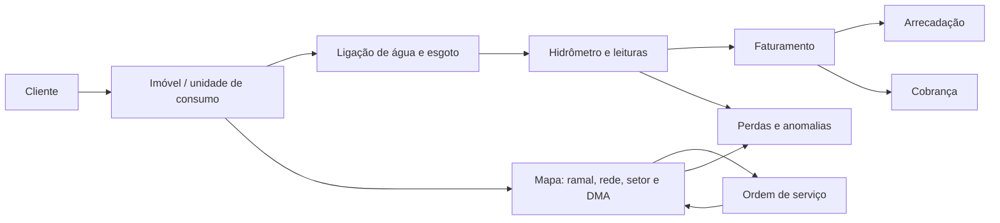

# Enriquecimento do Ziip SAN a partir de GSAN e GEOSAN

Data da análise: 11 de outubro de 2026  
Objetivo: transformar as capacidades encontradas nas referências abertas **GSAN** (gestão comercial de saneamento) e **GEOSAN** (GIS de redes) em um backlog de produto moderno para o Ziip SAN.

> Esta é uma análise funcional, não uma proposta de migração ou cópia de código. GSAN e GEOSAN são referências de domínio e cobertura operacional; qualquer reutilização direta de código, documentos, imagens ou dados exige verificação de licença, atribuição e compatibilidade técnica.

## Resumo executivo

O Ziip SAN já tem uma fundação técnica forte para multiempresa, segurança de dados e módulos especializados de perdas, qualidade, GIS, resíduos e LGPD. O maior vazio está entre essa fundação e a operação diária de uma concessionária: **cadastro comercial, ciclo de leitura/faturamento/arrecadação/cobrança, atendimento e ordens de serviço**.

O GSAN é valioso por sua profundidade de processos comerciais. O GEOSAN é valioso porque mostra como associar o cadastro comercial à rede física e transformar o mapa em ferramenta de operação, não somente de visualização. A recomendação é criar um núcleo comercial orientado a eventos e APIs, com GIS como contexto transversal do imóvel, ligação, ativo e ordem de serviço.

### Prioridades propostas

| Prioridade | Entrega | Por quê |
|---|---|---|
| P0 | Cadastro mestre de cliente, imóvel, ligação e economia | É a base de leitura, faturamento, atendimento, GIS e perdas. |
| P0 | Medição, leitura e crítica de consumo | Transforma o módulo de medição planejado em insumo confiável para faturamento e perdas. |
| P0 | Faturamento: tarifa, conta, débito/crédito, revisão e histórico | Fecha o ciclo comercial mínimo. |
| P1 | Arrecadação e conciliação bancária | Fecha o ciclo financeiro e reduz trabalho manual. |
| P1 | Atendimento, solicitação e ordem de serviço georreferenciada | Conecta cidadão, campo, rede e cobrança. |
| P1 | Console GIS operacional | Permite localizar ativos, consumidores afetados e intervenções. |
| P2 | Cobrança parametrizável, parcelamento e negativação | Alto valor, porém depende do ciclo financeiro maduro e de políticas locais. |
| P2 | Simulação hidráulica real e cenários de perdas | O módulo atual declara corretamente que o solver é um stub; não deve virar promessa antes da implementação. |

## O que foi analisado

| Fonte | Evidência analisada | Leitura funcional |
|---|---|---|
| GSAN | `README.md`, taxonomia de pacotes em `src/gcom`, cerca de 7.804 classes Java e 1.606 JSPs | Sistema comercial maduro: cadastro, micromedição, faturamento, arrecadação, cobrança, atendimento, segurança, relatórios e integrações. |
| GEOSAN | formulários VB6 em `trunk/Forms`, documentos de exportação EPANET e scripts SQL | GIS operacional: temas/camadas, rede, ramais, ligação/consumo no mapa, consumidores afetados, DXF e EPANET. |
| Ziip SAN | diário técnico, POMs, migrations e front-end atual | Núcleo técnico e domínio especializado existentes; módulos comercial e operações ainda não implementados. |

## Direção de produto recomendada

O Ziip SAN deve ter uma fonte de verdade comercial única e projetar o GIS como uma capacidade integrada:

Princípios para não reproduzir os limites do legado:

- APIs e eventos no lugar de telas monolíticas acopladas ao banco.
- Um modelo de domínio explícito, com histórico e auditoria, não uma coleção de tabelas auxiliares sem semântica.
- GIS como objeto de negócio: o ativo espacial possui identificador, estado, versão, responsável, evidências e vínculo com OS.
- Configuração por tenant para tarifas, calendários, regras de crítica, fluxos de cobrança e SLA.
- LGPD desde o desenho: finalidade, minimização de dados, retenção, masking e acesso por função/abrangência.

## Capacidades herdáveis do GSAN

### 1. Cadastro comercial e territorial — P0

O GSAN possui áreas específicas para cliente, imóvel, endereço, localidade, unidade, tarifa social, atualização cadastral e cadastro geográfico. A principal contribuição é a modelagem da relação muitos-para-muitos entre pessoas, imóveis, economias, ligações e contas — e não apenas um cadastro de “consumidor”.

**Funcionalidades propostas para o Ziip SAN**

| Capacidade | Regra/resultado esperado |
|---|---|
| Cliente / responsável | CPF/CNPJ, nomes, contatos, preferências, representação, status e consentimentos. Uma pessoa pode responder por vários imóveis. |
| Imóvel / unidade de consumo | Matrícula imutável, endereço normalizado, coordenada, categoria/subcategoria, economias, ocupação, situação cadastral e vínculo GIS. |
| Ligação de água e esgoto | Número de ligação, situação, datas, diâmetro/material, ramal, setor de abastecimento/DMA, destino de esgoto e geometria. |
| Tarifação social e benefícios | Elegibilidade, documentos, vigência, revisão e trilha de auditoria; nunca um campo booleano permanente. |
| Recadastramento de campo | Lote de imóveis, formulário móvel offline, fotos, documentos, coordenada, divergências, revisão e aprovação. |
| Atualização cadastral guiada | Comparação “antes/depois”, responsável, justificativa, anexos e aprovação conforme risco. |

**Formulários/telas**

1. **Ficha 360° do imóvel**: matrícula, endereço, mapa, cliente(s), ligações, economias, hidrômetros, últimas leituras, contas, débitos, OS e anexos.
2. **Cadastro de cliente**: identificação, contatos, preferências de comunicação, procuradores, documentos e LGPD.
3. **Assistente de nova ligação**: endereço → viabilidade GIS → dados técnicos → taxa/orçamento → OS → ativação.
4. **Recadastramento em campo**: dados pré-preenchidos, evidência fotográfica, localização, alterações propostas e assinatura.
5. **Busca unificada**: matrícula, ligação, CPF/CNPJ, endereço, hidrômetro, coordenada e número de OS.

### 2. Micromedição, leitura e crítica — P0

No GSAN, a divisão entre hidrômetro e leitura é explícita. Isso deve se tornar um fluxo de dados auditável no Ziip SAN, com leituras manuais, importadas, telemétricas e estimadas claramente diferenciadas.

**Funcionalidades propostas**

- Cadastro e ciclo de vida do hidrômetro: instalação, lacre, substituição, remoção, aferição e histórico de posição.
- Rotas de leitura por setor, quadra, sequência, DMA ou geografia desenhada no mapa.
- Aplicativo do leiturista: offline, foto do visor, GPS, motivo de impedimento e assinatura/observação.
- Motor de crítica: consumo zero, salto, retrocesso, leitura incompatível, ausência, média histórica e comparação com pares do setor.
- Tratamento de exceções: re-leitura, estimativa justificável, inspeção e OS automática.
- Curva de consumo por imóvel e por DMA; uso como insumo rastreável para perdas.

**Formulários/telas**

| Tela | Campos/ações essenciais |
|---|---|
| Hidrômetro | série, fabricante, modelo, diâmetro, classe, leitura inicial, lacre, situação, posição e localização. |
| Rota de leitura | ciclo, competência, agrupamento espacial, sequência, equipe, prazo e quantidade planejada. |
| Coleta de leitura | matrícula, foto, leitura atual, GPS, observação, impedimento e validação de faixa. |
| Fila de críticas | motivo, valor esperado/observado, histórico, evidência, decisão e responsável. |
| Histórico de consumo | série mensal, médias, anomalias, consumo faturado versus medido e correções. |

### 3. Faturamento, conta e tarifas — P0

O GSAN evidencia elementos que muitas soluções esquecem: retificação, cancelamento, vencimento alternativo, mensagens na conta, débito/crédito, qualidade da água, consumo por faixa e simulação.

**MVP de faturamento do Ziip SAN**

- Tabela tarifária versionada por tenant, localidade, categoria/subcategoria, serviço e faixa de consumo.
- Competência, calendário, grupos/rotas, cálculo reproduzível e fechamento controlado.
- Conta com memória de cálculo: leitura anterior/atual, consumo, faixas, água, esgoto, tributos, serviços, crédito, débito e mensagem.
- Estados: prévia, emitida, vencida, paga parcialmente, paga, cancelada, retificada e em negociação.
- Simulador interno e de atendimento, sempre sem gravar até a confirmação.
- Retificação/cancelamento somente por motivo, permissão, evidência e vínculo à conta original.
- Impressão, PDF, segunda via, código de barras/PIX e entrega digital com rastreabilidade.

**Formulários/telas**

1. Configurador de tarifas e faixas com vigência, aprovação e simulação de impacto.
2. Painel de fechamento por ciclo: pendências de leitura, críticas abertas, contas a emitir e exceções.
3. Consulta de conta: PDF, memória de cálculo, histórico, pagamentos, revisões, anexos e log.
4. Assistente de revisão de conta: motivo, período, leitura/evidência, nova memória de cálculo, aprovação e comunicação.
5. Editor de mensagem de fatura por público, localidade, vigência e canal.

### 4. Arrecadação e conciliação — P1

As áreas de banco, pagamento e aviso do GSAN apontam para um bloco essencial que ainda não aparece no Ziip SAN: processamento de retorno bancário e conciliação operacional.

**Funcionalidades propostas**

- Convênios, bancos, canais, layout de remessa/retorno e credenciais por tenant.
- Importação e validação de arquivos de retorno; deduplicação por identificador bancário.
- Baixa total, parcial, em duplicidade, fora do prazo e não identificada.
- Tela de conciliação com fila de exceções, sugestão de vínculo e aprovação em dupla checagem para ajustes manuais.
- Integração PIX/QR e conciliação por end-to-end ID.
- Relatórios de arrecadação diária, inadimplência, divergências e eficiência por canal.

### 5. Cobrança, negociação e recuperação — P2

O GSAN apresenta critérios, cronogramas, ações, campanhas, parcelamento, corte/religação e integração de negativação. A oportunidade não é reproduzir todas as telas, e sim construir um **motor de jornadas de cobrança** configurável.

**Funcionalidades propostas**

- Segmentação por saldo, atraso, categoria, localidade, vulnerabilidade/tarifa social, risco e histórico.
- Jornadas versionadas: lembrete, aviso, negociação, inspeção, suspensão, negativação e encerramento.
- Regras de elegibilidade e bloqueios legais/operacionais antes de qualquer ação restritiva.
- Parcelamento com entrada, juros/desconto, vencimentos, quebra de acordo e termo digital.
- Ordem de serviço de corte/religação gerada a partir de decisão auditável; retorno de campo atualiza a jornada.
- Adaptadores para bureaus de crédito, sem acoplar a regra de negócio a um fornecedor.

**Formulários/telas**

- Política de cobrança: público-alvo, condições, ações, canal, prazo, aprovação e vigência.
- Negociação: débitos selecionados, simulações, entrada, parcelas, aceite e termo.
- Central de casos: linha do tempo, contatos, documentos, pagamentos, ações pendentes e impedimentos.
- Operação de campo: lista priorizada no mapa, check-in, foto, motivo de não execução e geolocalização.

### 6. Atendimento ao público e ordens de serviço — P1

O GSAN separa registro de atendimento, ligação de água, ligação de esgoto, hidrômetro e OS. Essa separação é útil: uma solicitação não é automaticamente uma OS, e uma solicitação pode gerar várias ordens.

**Funcionalidades propostas**

- Protocolo omnicanal: balcão, portal, telefone, WhatsApp/API e campo.
- Catálogo de serviços com SLA, documentos, taxas, elegibilidade, checklist e roteamento.
- Triagem, vinculação ao imóvel/cliente, classificação de urgência e comunicação automática.
- OS com equipe, agenda, etapas, materiais, fotos, assinatura, GPS, causa, solução e custo.
- Reabertura, transferência, cancelamento e auditoria do fluxo.
- Painel de SLA por serviço, localidade, equipe, causa e reincidência.

## Capacidades herdáveis do GEOSAN

### 1. Cadastro espacial de rede e ramais — P1

O GEOSAN contém formulários para cadastro de ramal de água/esgoto, ramal em lote, atualização de setores, consulta de consumo e ligação a partir do mapa. Essa é a ligação prática entre o cadastro comercial e a engenharia de rede.

**Modelo sugerido**

| Entidade espacial | Dados mínimos |
|---|---|
| Nó | código, tipo, cota, pressão observada/calculada, situação e geometria. |
| Trecho | código, rede, material, diâmetro, extensão, instalação, condição, válvulas a montante/jusante e geometria. |
| Ramal | imóvel/ligação, tipo água/esgoto, material, diâmetro, profundidade, status, geometria e data de ativação. |
| Equipamento | hidrante, registro, válvula, bomba, reservatório, medidor de vazão/pressão, telemetria e histórico de manutenção. |
| Setor/DMA | limite poligonal, entradas/saídas, medidores, responsáveis, consumidores e indicadores. |

**Telas propostas**

- Editor de rede: camadas, snapping, validação topológica, versionamento, importação e revisão antes de publicar.
- Painel da ligação no mapa: imóvel, ramal, rede associada, hidrômetro, histórico de consumo, OS e fotos.
- Cadastro de ramal em lote: seleção por polígono, modelo de ramal, quantidade, consumo estimado, revisão e aplicação em massa auditável.
- Validador de rede: nós desconectados, trechos sem diâmetro/material, geometrias inválidas, conexões impossíveis e duplicidades.

### 2. Impacto operacional por área ou trecho — P1

O formulário `frmConsumidoresDesabastecidos` lista ligações presentes em trechos selecionados, incluindo ligação, endereço, usuário e telefones, e permite exportar a lista. É uma capacidade de alto valor para interrupções e manutenção.

**Funcionalidades propostas**

- Selecionar trechos/válvulas, simular isolamento e calcular imóveis/serviços afetados.
- Gerar lista de impacto com contatos consentidos, hospital/escola/unidade crítica, tarifa social e vulnerabilidades operacionais.
- Criar incidente e comunicações segmentadas (SMS/e-mail/WhatsApp/push) com template, janela prevista e atualização de status.
- Associar a interrupção a uma OS e exibir restauração no mapa.
- Registrar impacto real versus previsto para aprimorar a topologia.

### 3. Integração CAD, GIS e EPANET — P2

O GEOSAN inclui importação/exportação DXF, seleção por tema/plano/itens no mapa e documentação de exportação EPANET. No Ziip SAN, isso deve ser entregue como pipeline governado, não como exportação manual sem histórico.

**Funcionalidades propostas**

- Importador versionado de DXF, Shapefile, GeoJSON e CSV georreferenciado com preview, mapeamento de atributos e relatório de erros.
- Exportações assíncronas para GeoJSON, DXF e relatórios geográficos, com filtro por seleção, camada, área e data.
- Gerador de cenário EPANET a partir de snapshot aprovado de rede, demanda e condições de contorno.
- Comparação de cenários e publicação apenas de resultados que indiquem explicitamente solver, versão do modelo, data, premissas e nível de confiança.

O módulo atual `sigsan-gis` já declara EPANET como stub. A tela deve mostrar claramente **“estimativa/topologia”** enquanto não houver solver, nunca pressão, vazão ou criticidade como se fossem calculadas.

### 4. Perdas e priorização territorial — P1/P2

O GEOSAN oferece consulta e alteração de consumo por polígono; o Ziip SAN já possui domínio de balanço hídrico, DMA, pressão e vazamento. A combinação é uma proposta forte: priorização por território baseada em telemetria real.

**Funcionalidades propostas**

- Dashboard de DMA: volume de entrada, consumo medido/faturado, perdas aparentes/reais, pressão, vazão mínima noturna, alarmes e confiança do dado.
- Seleção espacial para investigação: polígono/trecho/DMA, consumidores, histórico de consumo, eventos e OS.
- Fila de suspeitas: anomalia de consumo, pressão, vazão, ordem recorrente, idade/material da rede e impacto estimado.
- Campanha de campo: área, hipótese, equipe, evidência, achado, reparo e benefício medido após intervenção.

## Formulários que merecem entrar no desenho do Ziip SAN

| Grupo | Formulário | Resultado de negócio |
|---|---|---|
| Cadastro | Ficha 360° do imóvel | Reduz consultas dispersas e melhora atendimento. |
| Cadastro | Recadastramento móvel | Melhora qualidade cadastral e evidência de campo. |
| Medição | Rota/coleta de leitura | Dá previsibilidade e qualidade à medição. |
| Faturamento | Tarifa e simulador | Torna cálculo auditável antes de faturar. |
| Faturamento | Revisão/retificação | Controla exceções sem apagar o histórico. |
| Arrecadação | Conciliação de retorno/PIX | Trata baixa automática e exceções financeiras. |
| Cobrança | Acordo de parcelamento | Formaliza negociação e evita regras em planilha. |
| Atendimento | Protocolo + OS | Separa demanda do cidadão da execução operacional. |
| GIS | Editor de ramal/rede | Conecta cadastro, ativo e localização. |
| GIS | Impacto de desabastecimento | Acelera comunicação e resposta a incidentes. |
| Perdas | Investigação por DMA/polígono | Transforma dados de rede em ação priorizada. |

## Arquitetura alvo: módulos e fronteiras

| Módulo Ziip SAN proposto | Responsabilidade | Integrações principais |
|---|---|---|
| `sigsan-commercial` | cliente, imóvel, ligação, tarifa, faturamento | tenant, GIS, LGPD, documentos, pagamentos |
| `sigsan-metering` | hidrômetros, rotas, leituras e críticas | comercial, campo, telemetria, perdas |
| `sigsan-revenue` | arrecadação, conciliação e contas a receber | bancos/PIX, comercial, cobrança |
| `sigsan-customer-care` | protocolos, catálogo de serviços e comunicação | comercial, OS, documentos, LGPD |
| `sigsan-field` | OS, agenda, equipes, materiais e evidências | atendimento, GIS, cobrança, ativos |
| `sigsan-gis` | ativos espaciais, rede, topologia, importação/exportação | campo, comercial, perdas, simulação |
| `sigsan-losses` | indicadores, anomalias e campanhas de investigação | medição, GIS, SCADA, campo |

Eventos de integração recomendados: `property.updated`, `connection.activated`, `meter.reading.recorded`, `reading.flagged`, `invoice.issued`, `payment.reconciled`, `collection.case.opened`, `service.request.created`, `work.order.completed`, `network.incident.opened` e `asset.geometry.updated`.

## Roadmap em quatro ondas

### Onda 1 — base comercial (P0)

1. Modelos e APIs de cliente, imóvel, economia, ligação e hidrômetro.
2. Cadastro/consulta 360° e busca unificada.
3. Rotas e leituras com crítica básica.
4. Tarifas, simulador e conta com memória de cálculo.
5. Eventos, auditoria, anexos e permissões desde o início.

**Critério de sucesso:** é possível cadastrar uma ligação, registrar leitura, simular e emitir uma conta auditável em um tenant de teste.

### Onda 2 — operação e arrecadação (P1)

1. Importação/conciliação de retorno bancário e PIX.
2. Protocolo, catálogo de serviços e OS.
3. Mapa operacional com imóveis, ligações, ramais e OS.
4. Impacto de desabastecimento e comunicação segmentada.

**Critério de sucesso:** uma ocorrência de rede gera OS, identifica afetados e atualiza a comunicação sem planilhas paralelas.

### Onda 3 — inteligência comercial e territorial (P1/P2)

1. DMA operacional com telemetria e qualidade de dados.
2. Investigação de perdas por território e evidências de campo.
3. Motor de cobrança e negociação configurável.
4. Relatórios gerenciais de arrecadação, inadimplência, consumo e SLA.

### Onda 4 — integrações e modelagem avançada (P2)

1. Conectores bancários/bureaus conforme contratos e conformidade.
2. Importação/exportação GIS governada.
3. Solver hidráulico real, validação de rede e cenários EPANET.
4. Aplicativo móvel de campo com offline e sincronização.

## Riscos e decisões que precisam ser preservados

- Não tratar a adoção do GSAN como migração de arquitetura: ele é Java legado, JBoss/Ant e grande acoplamento de telas JSP; o valor está no domínio, fluxos e exceções que ele revela.
- Não permitir que dados comerciais do GSAN ou do GIS bypasssem o isolamento do tenant já implementado no Ziip SAN.
- Não executar alterações de consumo, atributos de rede ou tarifas em lote sem prévia, aprovação, auditoria e rollback lógico.
- Não expor endereço, telefone ou lista de afetados fora da finalidade operacional e das permissões LGPD.
- Não apresentar resultados de EPANET como calculados antes de existir um solver efetivamente executado e testado.
- Não começar por negativação/corte: começar pela qualidade de cadastro, medição, cálculo de conta e conciliação.

## Evidências de referência

### GSAN

- `G:\Meu Drive\PROJETOS\Diversos\FONTES OPEN\GSAN\README.md` — escopo oficial: segurança, cadastro, micromedição, faturamento, cobrança, arrecadação e atendimento.
- `G:\Meu Drive\PROJETOS\Diversos\FONTES OPEN\GSAN\src\gcom\gui` — módulos de interface organizados por domínio.
- `G:\Meu Drive\PROJETOS\Diversos\FONTES OPEN\GSAN\gcom\jsp\cadastro`, `faturamento`, `cobranca`, `arrecadacao`, `atendimentopublico` e `micromedicao` — inventário dos fluxos/formulários legados.
- `G:\Meu Drive\PROJETOS\Diversos\FONTES OPEN\GSAN\documents\recadastramento` — layouts e scripts de atualização cadastral.

### GEOSAN

- `G:\Meu Drive\PROJETOS\Diversos\FONTES OPEN\GEOSAN\trunk\Forms\frmCadastroRamalAgua.frm` e `frmCadastroRamalEsgoto.frm` — cadastro de ramais e ligações.
- `G:\Meu Drive\PROJETOS\Diversos\FONTES OPEN\GEOSAN\trunk\Forms\frmAlteraConsumoPorPoligono.frm` — seleção espacial e tratamento de consumo em lote.
- `G:\Meu Drive\PROJETOS\Diversos\FONTES OPEN\GEOSAN\trunk\Forms\frmConsumidoresDesabastecidos.frm` — consumidores afetados por trechos selecionados.
- `G:\Meu Drive\PROJETOS\Diversos\FONTES OPEN\GEOSAN\trunk\Forms\FrmExport.frm` — exportação DXF por seleção, plano ou tema.
- `G:\Meu Drive\PROJETOS\Diversos\FONTES OPEN\GEOSAN\doc\07 - Exportacao Epanet-5.9.9.1.doc` — referência de integração hidráulica; documento legado não pôde ser convertido automaticamente.

### Ziip SAN

- `G:\Meu Drive\PROJETOS\Ziip SAN\sigsan\docs\DIARIO-DE-BORDO.md` — estado atual, stubs conhecidos e próximos passos.
- `G:\Meu Drive\PROJETOS\Ziip SAN\sigsan\frontend\src\services\api.ts` — superfícies de API pretendidas para comercial, operação, GIS, perdas, qualidade, resíduos e LGPD.

