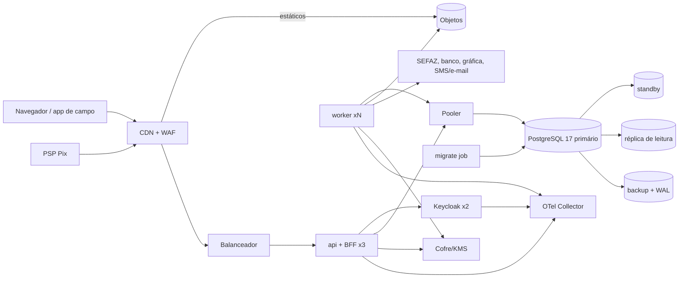

# Arquitetura-alvo de produção

Base: revisão 17 (§4 e §5) e ADRs 0003, 0005, 0006, 0007, 0010, 0012, 0013, 0014, 0018, 0020 e 0022. Neutra quanto a
provedor enquanto o ADR-0011 estiver pendente. Metas em `REQUISITOS-NAO-FUNCIONAIS.md`. Os nomes de roles abaixo
(`sigsan_*`) passam a `ziipsan_*` na renomeação do P0 (plano P0.33).

## 1. Componentes

Monólito modular: um artefato (imagem única, não-root, assinada) executado em três processos.

| Componente | Papel |
|---|---|
| Borda | DNS, CDN e WAF; TLS 1.3, HSTS, CSP, rate limit por IP; SPA em armazenamento de objetos com assets imutáveis; `/api` e `/bff` para o balanceador |
| `api` | REST e BFF (ADR-0006) no mesmo processo; 3+ réplicas sem afinidade; sessão do BFF no PostgreSQL; role `sigsan_app` |
| `worker` | Outbox, lote, retorno bancário, fiscal (ADR-0003), PDFs, notificações e coletor da Central Ziip (ADR-0018); réplicas por fila; role `sigsan_worker` |
| ClamAV | Varredura dos arquivos enviados (anexos de chamados e logos de tenant), junto do `worker`, com quarentena até a varredura; substituível pelo serviço da hospedagem (exceção do ADR-0010) |
| `migrate` | Job antes de cada rollout; único detentor da credencial `sigsan_migrator` |
| Keycloak 26.8 | 2+ réplicas, `start --optimized`, banco próprio; MFA conforme ADR-0007 |
| PostgreSQL 17 + PostGIS 3.5 | Primário com standby síncrono, PITR e réplica de leitura para relatórios e SINISA (ADR-0013); pooler em modo transaction |
| Armazenamento de objetos | Prefixo e chave por tenant; retenção imutável para documentos fiscais (XML autorizado servido como gravado, ADR-0022) |
| Outbox | Tabela no PostgreSQL, workers com `SKIP LOCKED` (ADR-0014) |
| Cofre/KMS | Segredos de execução, KEK e DEK por tenant (R1) |
| Observabilidade | OpenTelemetry Collector para métricas, logs e traces; error tracking; página de status pública em hospedagem separada da produção (ADR-0020) |
| CI/CD | GitHub Actions: testes, imagem com SBOM, homologação, produção com aprovação manual e rollback |

Kafka, Redis, MinIO, TimescaleDB e Loki/Tempo/Pyroscope ficam fora até haver caso concreto (ADR-0010). A única
exceção registrada até aqui é o ClamAV (ADR-0010, seção Exceções).

## 2. Fluxos críticos

1. **Requisição autenticada.** O navegador envia só o cookie `__Host-` HttpOnly ao `/bff`. O BFF obtém o access token
   da sessão, renova com rotação quando necessário e chama a API internamente. A API valida emissor, audiência e
   `tenant_id` contra o catálogo, abre a transação, aplica o contexto local (§4) e a RLS filtra.
2. **Faturamento em lote.** O operador abre o ciclo; `job_runs` recebe trava única `(tenant, ciclo)`. O ciclo é
   particionado por rota, cada rota vira uma mensagem na fila `billing`. O worker processa em blocos com commit e
   checkpoint (última ligação); falha retoma do checkpoint; `UNIQUE (ciclo, ligação)` impede conta duplicada. Ao fim,
   a mesma transação de cada bloco publica as mensagens fiscais e de gráfica.
3. **Emissão fiscal.** A mensagem `fiscal.emitir` nasce na transação da conta. O worker monta a NFAg-e, assina com o
   certificado do cofre, envia por mTLS e grava o protocolo. Retry com backoff e jitter; idempotência por
   `(conta, modelo, série)`; rejeição vai para a fila de pendências do operador; contingência conforme o leiaute.
4. **Webhook Pix.** A API valida a origem e a assinatura do PSP, grava em `pix_inbox` com
   `UNIQUE (psp, end_to_end_id)` e `ON CONFLICT DO NOTHING`, e responde 200. O worker concilia e baixa a conta. Uma
   consulta diária ao PSP recupera notificações perdidas.
5. **Sincronização de campo.** O app guarda leituras offline com `client_reading_id` (UUIDv7) e envia lotes de até 500.
   A API grava com `UNIQUE (client_reading_id)` e responde item a item (aceita, duplicada, rejeitada). A crítica de
   leitura roda no worker. A carga de rota usa delta por `updated_at` com keyset.
6. **Migração em ondas.** O job `migrate` aplica o core e depois os tenants com paralelismo limitado, em ondas: tenant
   sintético, canário (1–2 tenants), 10%, restante. `tenant_schema_version` registra o status; falha põe o tenant em
   quarentena sem parar os demais. Mudanças em expand/contract, compatíveis com as versões N e N-1 da aplicação;
   `outOfOrder` desligado.
7. **Provisionamento.** O console da plataforma (MFA obrigatório) cria o tenant no catálogo como `PROVISIONANDO`, com
   porte e shard; recusa schema existente; cria estrutura conforme o porte, DEK no KMS, organização e primeiro
   administrador no Keycloak (convite) e parâmetros G com aceite (ADR-0002); só então `ATIVO`. Cada passo é
   idempotente e retomável pela outbox.

## 3. Multi-tenant híbrido e roteamento

| Porte (ADR-0005) | Ligações | Dados | Lote |
|---|---|---|---|
| Pequeno | até 20 mil | Schema próprio (padrão do ADR-0005); autarquia muito pequena pode dividir schema com `tenant_id` e RLS, sob demanda (P4.6) | Workers compartilhados, 1 partição simultânea |
| Médio | 20–200 mil | Schema próprio no cluster compartilhado | Fila e janela de lote próprias |
| Grande | acima de 200 mil | Cluster dedicado | Workers dedicados |

O `tenant_catalog` ganha `porte`, `shard_id` e `schema`. Cada shard tem pool próprio; o roteador resolve
`tenant → shard → schema` a partir do JWT, com cache em memória invalidado por evento. Mudança de porte é migração
assistida com janela.

## 4. Conexões e contexto de tenant

- Pools separados por processo e finalidade: `api` (20 por réplica), `ingestao` (webhook e sincronização, 5 por réplica,
  para não disputar com o backoffice), `worker` (10 por réplica). Todos com `connectionTimeout`, `maxLifetime` e
  métricas.
- Roles: `sigsan_app` com `statement_timeout` de 5 s; `sigsan_worker` com 15 min; ambas com
  `idle_in_transaction_session_timeout` de 30 s e sem BYPASSRLS.
- Contexto transacional: `search_path`, `app.current_tenant` e `app.current_user` aplicados com
  `set_config(..., true)` no início de cada transação, o que torna o pooler em modo transaction seguro. Hoje o escopo é
  de sessão (`MultiTenantConnectionProvider.java:39-47`).
- `current_tenant_id()` reescrita como SQL `STABLE`.

## 5. Partição e retenção

| Tabela | Chave de partição | Retenção (a confirmar no RNF-40) |
|---|---|---|
| `audit_log` | Mês de `created_at`, PK `(created_at, id)` UUIDv7, `pg_partman` | 13 meses no banco; depois exportada para objetos imutáveis até o prazo legal |
| `bills`, `bill_items`, `payments` | Competência | Prazo fiscal e regulatório; histórico de 120 meses |
| `meter_readings` | Data da leitura | Idem |
| `outbox`, `pix_inbox` | Dia | 30 dias após processamento |

Em schema próprio a partição é anual, para limitar o catálogo (76 tabelas por tenant hoje, D2); no compartilhado,
mensal. Nas tabelas de lote a auditoria é por bloco, com `run_id`, e não por linha (X3).

## 6. Dimensionamento inicial

Valores de partida para o piloto, a validar pela carga de referência (RNF-70):

| Componente | Inicial |
|---|---|
| `api` | 3 × 2 vCPU / 4 GB |
| `worker` | 2 × 2 vCPU / 4 GB, autoscaling pela fila |
| Keycloak | 2 × 1 vCPU / 2 GB |
| PostgreSQL | 4 vCPU / 16 GB / 500 GB SSD, mais standby e réplica de leitura |
| Cluster dedicado (grande) | 8 vCPU / 32 GB, workers próprios |

## 7. Mapeamento por hospedagem (ADR-0011)

| Componente | AWS sa-east-1 | Azure Brasil | VPS/servidor próprio |
|---|---|---|---|
| CDN e WAF | CloudFront + AWS WAF | Front Door Premium com WAF | Cloudflare ou Nginx com ModSecurity |
| Balanceador | ALB | Front Door / Application Gateway | HAProxy em par com keepalived |
| `api`, `worker`, Keycloak | ECS Fargate | Container Apps | Docker em 3+ hosts (Compose ou k3s) |
| `migrate` | Tarefa ECS avulsa | Container Apps Job | Container avulso no pipeline |
| PostgreSQL com HA | RDS Multi-AZ | Flexible Server com HA por zona | Patroni + etcd em 3 nós |
| Réplica de leitura | Read replica RDS | Read replica | Standby de streaming |
| Pooler | PgBouncer próprio (RDS Proxy só após teste de pinning) | PgBouncer embutido | PgBouncer |
| Backup e PITR | Backup automático + snapshot em outra conta | Backup do Flexible Server (geo-redundância pareia fora do Brasil) | pgBackRest em outro datacenter no Brasil |
| Objetos | S3 com Object Lock | Blob com imutabilidade | S3 compatível nacional ou MinIO dedicado (ADR-0010) |
| Cofre/KMS | KMS + Secrets Manager | Key Vault | OpenBao/Vault em 3 nós, KEK com cópia offline |
| Observabilidade | CloudWatch, X-Ray ou Managed Prometheus/Grafana | Azure Monitor, Application Insights | Prometheus + Grafana auto-hospedados ou SaaS sem dado pessoal |
| Registro de imagens | ECR | ACR | GHCR |

## 8. Lacunas em relação ao estado atual

| Achado | Estado atual | Alvo |
|---|---|---|
| X1 | Sem Dockerfile, CI remoto ou ambientes | Imagem única e pipeline com homologação |
| X2 | PG 15 em nó único, sem backup | PG 17 com HA, PITR e restauração testada |
| X3 | `audit_log` sem partição, gatilho por linha | Partição mensal; auditoria por bloco no lote |
| X4 | Sem lote nem assíncrono | Outbox e processo `worker` |
| D1 | Rollout sequencial, `outOfOrder(true)` | Ondas com canário e quarentena |
| D2 | Só schema por tenant | Híbrido por porte com shard |
| D3 | Pool único, contexto de sessão | Pools separados, contexto local |
| S2 | Credencial de migração na JVM | Só no job `migrate` |
| S3, S4 | Realm único sem MFA | Organizações, MFA por política |
| S5 | Token em `sessionStorage`, sem CSP | BFF com cookie, CSP estrita |
| O1 | Sem métricas nem traces | OpenTelemetry e SLOs |
| O2 | Terraform em `us-east-1` | Região brasileira após ADR-0011 |
| O3 | Keycloak `start-dev` | 2+ réplicas com TLS |
| O4 | Sem metas nem carga | RNF e k6 no CI |
| P1, P2 | Sem console nem portal | Console e Central v0 (P1), Central completa e portal com histórico e documentos (P3) |
