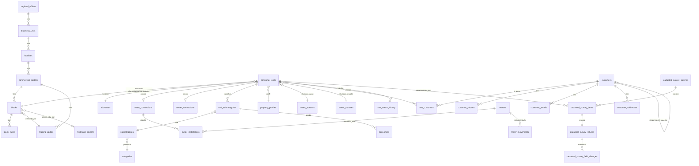

# Levantamento 01 — GSAN: visão geral e domínio de CADASTRO

Fonte analisada: `G:\Meu Drive\PROJETOS\Diversos\FONTES OPEN\GSAN` (somente leitura).
Data do levantamento: 11/10/2026. Objetivo: extrair CONCEITOS, modelo de domínio, regras e catálogos para o SIGSAN. Nenhum código foi copiado.

Convenções deste documento:
- **[FATO]** = visto diretamente em arquivo (caminho citado). **[INFERÊNCIA]** = dedução minha, a confirmar.
- Contagens de arquivos vêm de `git ls-files src/gcom` (índice do git; a árvore de trabalho no Drive não foi varrida).
- O DDL do banco **não está neste repositório** (ver seção 2.3); os nomes de tabela/coluna vêm dos mapeamentos Hibernate `*.hbm.xml`.

---

## 1. Resumo executivo

1. O GSAN é um ERP comercial de saneamento (cadastro, ligações, medição, faturamento, arrecadação, cobrança, financeiro, atendimento/OS, segurança, gerencial) da era Java 5/6 + EJB 2 + Struts 1.1 + Hibernate 3 + JBoss 4. Valor para o SIGSAN: o **modelo de domínio e os catálogos**, não a arquitetura.
2. O centro do cadastro é o **Imóvel** (matrícula numérica com dígito verificador; inscrição Localidade.Setor.Quadra.Lote.Sublote), ligado a **Clientes** por uma relação **temporal** (proprietário, usuário, responsável), com **categorias/subcategorias/economias**, **ligação de água**, **ligação de esgoto** e **hidrômetro** (instalação com histórico).
3. A hierarquia territorial-comercial é: Gerência Regional > Unidade de Negócio > Localidade > Setor Comercial > Quadra (> Face) > Imóvel, com **Rota de leitura** pendurada no setor/quadra. A quadra carrega "tem rede de água/esgoto" e consistência com a situação da ligação.
4. As **situações de ligação** (água: 9 estados; esgoto: 6) são um catálogo dirigido por flags (fatura? tem rede? tem ligação? abastece? consumo mínimo?), não `if` sobre ids. Padrão bom para absorver.
5. O **recadastramento (atualização cadastral)** é um fluxo maduro: arquivo posicional para coletor móvel, retorno em tabelas de staging, 23 validadores, aprovação campo a campo (individual/lote/pré-aprovado), revisão, fiscalização por amostragem e revisita. Há um layout oficial documentado em `documents/recadastramento/layouts/Layout_Cadastro.xlsx`.
6. Anti-padrões a NÃO herdar: fachada de 40.222 linhas, controladores EJB duplicados por empresa (42 dos 73 `*SEJB`), linhas "sentinela" (id 0 = não informado), estado de faturamento misturado dentro de `imovel`, coordenadas como String, flags 1/2 em vez de boolean.
7. **Licença: nenhum arquivo de licença no repositório** e nenhum cabeçalho nos fontes; o README cita o Portal do Software Público Brasileiro. Tratar como "licença não verificada; provável GPL" (seção 2). Risco de contaminação só existe se código/estrutura expressiva for copiado: usar apenas como referência conceitual.
8. O SIGSAN hoje tem **só** `consumer_units`, `addresses` (genérica), `users/roles`, `documents`, `service_orders`. **Não existe entidade Cliente**, categoria, tarifa, localidade/quadra/rota, ligação nem hidrômetro como tabelas (as colunas `category_id`, `tariff_type_id`, `reading_route_id`, `meter_id` são UUIDs soltos, sem FK).
9. Achado colateral no SIGSAN (verificado na leitura, confirmar com teste): `BaseEntity` não tem `@Id` nem `@Version`, e `V1_1__create_tenant_schema.sql` não cria as colunas `version` e `tenant_schema` que `BaseEntity`/`TenantAwareEntity` declaram. Mesma família do bug do `audit_log` registrado no diário. Corrigir antes de mapear qualquer entidade de cadastro.

---

## 2. Licença, procedência e riscos

| Item | Achado |
|---|---|
| Arquivo de licença na raiz | **Não existe** (raiz: `.gitignore .project MANIFEST.MF README.md build.xml ...`; `git log --all` sem LICENSE/COPYING) [FATO] |
| Cabeçalho de licença nos fontes | **Ausente** em `src/gcom/cadastro/imovel/Imovel.java` (começa em `package`); `git grep GPL` só acha libs JS/CSS de terceiros (jQuery, jqGrid) [FATO] |
| README | "O GSAN é um software livre ... desenvolvido e disponibilizado pelo Ministério das Cidades", cita Portal do Software Público Brasileiro (`softwarepublico.gov.br`) [FATO] |
| Remote git | `origin https://softwarepublico.gov.br/gitlab/gsan/gsan.git` [FATO] |
| Licença provável | Software Público Brasileiro costuma ser publicado sob **GPL v2** [INFERÊNCIA, de conhecimento geral; **verificar** na página do projeto no Portal antes de qualquer decisão] |
| Procedência | Autoria Cosanpa (`MANIFEST.MF`: `Created-By: Cosanpa`; `sonar-project.properties`: `cosanpa:gsan`); commits de 21/11/2013 a 30/08/2018, 2.166 commits, principais autores Pamela Gatinho, Felipe, Marcelo de Brito Garcia, Paulo Igor [FATO] |
| Terceiros embutidos em `lib/` | Hibernate 3 (LGPL), JasperReports 1.2.2 / JFreeChart 1.0.0 (LGPL), iText 1.3.1 (MPL/LGPL), POI 2.5.1, Quartz 1.5.2, Axis2 1.5.1, Jersey 1.18.1, Gson 2.2.4 (Apache), Struts 1.1, libs JBoss (LGPL), barbecue 1.1 [FATO sobre os jars; licenças por conhecimento geral] |
| Material de marca | `gcom/imagens/compesa_foto02.jpg`, relatórios `*Caern*.jrxml` com layout/branding de concessionárias [FATO] |

**Riscos de contaminação e regra de trabalho**
- Se a licença for GPL v2, copiar código, `.hbm.xml`, JSPs ou os 500 `.jrxml` para o SIGSAN poderia tornar o SIGSAN derivado e sujeito a copyleft. **Proibido copiar**: classes, mapeamentos, validadores, relatórios Jasper, SQL, imagens, textos de mensagens.
- Permitido (ideias/fatos, sem expressão): lista de entidades e relações, nomes de conceitos, regras de negócio descritas em português próprio, catálogos de valores de domínio (ex.: estados de ligação), estrutura de campos do layout de arquivo (fato de interoperabilidade).
- Cuidado extra: ids numéricos de catálogo (ex.: `Subcategoria.RESIDENCIAL_R1 = 1`) refletem dados de uma empresa; no SIGSAN, catálogos são configuráveis por tenant, nunca ids fixos.
- Cuidado com PII: o repositório não contém dados reais de clientes (apenas código e scripts), mas os relatórios e testes podem; não importar nada.

---

## 3. Stack, build e organização em camadas

### 3.1 Stack e versões [FATO, salvo indicação]

| Camada | Tecnologia | Evidência |
|---|---|---|
| Linguagem/JVM | Java 1.5/1.6 | `README.md` |
| Servidor | JBoss 4.0.1sp1 (EAR `gcom.ear` com módulos EJB + `gcom.war`) | `README.md`, `META-INF/application.xml`, `build.xml` |
| Banco | PostgreSQL 9.3.4; schemas por módulo (`cadastro.`, `atendimentopublico.`, `micromedicao.`, `operacional.`, `seguranca.`, `atualizacaocadastral.`) | `README.md`, `*.hbm.xml` |
| Migração de banco | MyBatis Migration, scripts em repositório separado `gsan-migracoes`, bancos **comercial** e **gerencial** | `README.md` |
| Build | Apache Ant (`build.xml`, `middlegen-build.xml`), scripts `scripts/build/*.sh`; versão Online ou Batch (`gsan.tipo`) | `build.xml`, `build.properties.exemplo` |
| ORM | Hibernate 3 com `.hbm.xml` ao lado de cada `.java` | `lib/hibernate/hibernate3.jar`, 802 `.hbm.xml` |
| Web | Struts 1.1 + JSP/JSTL + JavaScript (jQuery/jqGrid), 1.598 JSPs em `gcom/jsp` (contagem conferida em 12/10/2026, ver 15a); ~2.992 classes `*Action` e 936 `*ActionForm` | `lib/struts1.1`, git ls-files |
| EJB | EJB 2.x: 73 `*SEJB` (stateless session beans com Home/Local/LocalHome/Remote), 155 MDBs de batch; descritores em `descriptors/` (478 arquivos `ejb-jar.xml`/`jboss.xml`) | git ls-files |
| Relatórios | JasperReports 1.2.2 + iReport, 500 `.jrxml` em `reports/`; API REST externa para relatório (`api/GsanApi.java` com Jersey+Gson) | `lib/jasper-report`, `src/gcom/api` |
| Agendamento | Quartz 1.5.2 (`util/agendadortarefas/AgendadorTarefas.java`), JMS/MDB para fila de batch | `lib/quartz`, `descriptors/batch*` |
| Web services | Axis2 1.5.1 (cliente SPC) | `src/gcom/integracao/webservice/spc` |
| Qualidade | Sonar, encoding `ISO-8859-1` (arquivos latin1) | `sonar-project.properties` |

### 3.2 Camadas (fluxo típico)

```
JSP + Struts Action/ActionForm (src/gcom/gui/**, 4.041 .java)
   -> Fachada (src/gcom/fachada/Fachada.java: 40.222 linhas; FachadaBatch)
      -> Controlador*SEJB (EJB 2 stateless; regras de negócio)  [73]
         -> Repositorio*HBM (HQL/SQL; variantes *PostgresHBM)   [67]
            -> entidade POJO + .hbm.xml (mesmo pacote)
Filtro* (592 classes): objetos de consulta caseiros (ParametroSimples, ParametroNulo...) 
   executados por ControladorUtil.pesquisar(filtro, Classe)
Transversal: interceptor/Interceptador (Hibernate Interceptor) + RegistradorOperacao
   -> auditoria por tabela/coluna (seguranca.transacao.*); Abrangencia (escopo por localidade)
Batch: batch/* (Processo, ProcessoIniciado, FuncionalidadeIniciada...) + 155 MDBs
```

Convenções de modelagem observadas [FATO]:
- PK numérica `Integer`, sequence por tabela (exceto `Imovel`: `generator class="assigned"`, id é a matrícula).
- Prefixo de 4 letras por tabela e sufixos tipados: `nn` número, `ds` descrição, `dt` data, `tm` timestamp, `ic` indicador, `cd` código, `qt` quantidade, `vo` volume, `vl` valor, `pc` percentual, `am` ano-mês (ex.: `imov_nnlote`, `clie_dtnascimento`).
- Toda tabela tem `*_tmultimaalteracao` (usada como **trava otimista manual**: `verificarImovelControleConcorrencia` compara timestamps em `ControladorImovelSEJB`) e a maioria `*_icuso` (1 = ativo, 2 = inativo; desativação lógica).
- Convenção booleana: **1 = SIM, 2 = NÃO** (`ConstantesSistema.SIM/NAO`), cuidado em qualquer importação de dados do GSAN.

### 3.3 Variação por empresa (anti-padrão)

Existem controladores duplicados por concessionária: `ControladorArrecadacao|Cadastro|Cobranca|Faturamento|Financeiro|Micromedicao` x `CAEMA, CAERN, CAER, COMPESA, COSAMA, COSANPA, JUAZEIRO` = **42 dos 73 `*SEJB`** [FATO por contagem de nomes]; descritores `arrecadacaoCAERN` etc.; constantes de empresa em `SistemaParametro` (`CODIGO_EMPRESA_FEBRABAN_*`) e até ids de localidades fixos em `cadastro/localidade/Localidade.java`. O GSAN resolve multi-empresa por **fork de código**; o SIGSAN resolve por **tenant + configuração** (já é a decisão do diário). Isso valida a tese do produto.

---

## 4. Inventário dos módulos funcionais (pacotes de `src/gcom/*`)

Contagem = arquivos `.java` / `.hbm.xml` no índice git. Faltam as classes que a tabela não lista (ex.: `Filtro*` entram no total).

| Pacote | .java | .hbm | O que faz (1 linha) |
|---|---:|---:|---|
| `cadastro` | 490 | 148 | Imóvel, cliente, localidade/setor/quadra, endereço/geografia, tarifa social, empresa, funcionário, parâmetros do sistema, dados censitários IBGE |
| `atendimentopublico` | 353 | 129 | Ligações de água/esgoto, Registro de Atendimento (130 arq.), Ordem de Serviço (240 arq.), agência reguladora |
| `atualizacaocadastral` | 26 | 11 | Retorno/staging do recadastramento (imóvel, cliente, fones, imagens, visita) |
| `micromedicao` | 176 | 59 | Hidrômetro (56), leitura (22), consumo (21), medição (9), rota, leiturista, roteiro por empresa, telemetria (`Telemetria*`) |
| `faturamento` | 306 | 100 | Conta, débito a cobrar, crédito a realizar, tarifa de consumo, auto de infração, grupos de faturamento |
| `arrecadacao` | 173 | 48 | Pagamentos, aviso bancário, arrecadador/banco, débito automático, guia de pagamento, BIG |
| `cobranca` | 351 | 114 | Ações/comandos de cobrança, parcelamento, contrato de parcelamento, cobrança por resultado, escritórios |
| `spcserasa` | 24 | - | Negativação (SPC/Serasa): comandos, movimentos, retornos (DDL no controlador/hbm de `cobranca`) |
| `financeiro` | 60 | 25 | Lançamentos contábeis, conta contábil, contas a receber contábil, devedores duvidosos |
| `gerencial` | 252 | 90 | Data mart/resumos (cadastro, faturamento, micromedição, cobrança, arrecadação, RA/OS), banco "gerencial" separado |
| `operacional` | 35 | 15 | Sistema/zona/setor de abastecimento, distrito operacional, bacia/sistema de esgoto, captação, produção de água |
| `seguranca` | 195 | ~45 | Usuário, grupo, funcionalidade, operação, permissão especial, abrangência, auditoria por coluna, solicitação de acesso |
| `batch` | 331 | 13 | Processo/funcionalidade iniciada, unidades de processamento; tarefas por módulo (faturar grupo, resumos, cartas...) |
| `relatorio` | 854 | - | Classes de relatório Jasper por módulo |
| `integracao` | 12 | 2 | Serviço terceiro/acompanhamento de serviço, UPA, retorno GIS (`GisRetornoMotivo`), webservice SPC |
| `portal` | 6 | - | "Loja virtual": ponto de entrada de autoatendimento |
| `api` | 10 | - | Cliente REST de relatórios (`GsanApi`, DTOs) |
| `util`, `tarefa`, `tagslib`, `interceptor`, `properties`, `fachada`, `gerador`, `model`, `persistence`, `enums`, `gui` | 124 / 7 / 2 / 5 / 14 / 2 / 1 / 1 / 1 / 2 / 4.041 | - | Infraestrutura, tags JSP, interceptor de auditoria, propriedades, fachada, enums (`Status`, `TipoCategoria`), camada web |

Total `src/gcom`: **8.610 arquivos**; `gcom/` (webapp): 3.629 arquivos; repositório: 13.342 arquivos. Nenhum teste automatizado relevante observado [INFERÊNCIA: só `ConsultaWebServiceTest` e `ImplementacaoTesteTarefa` apareceram].

Subpacotes de `cadastro` (arquivos): `imovel` 186, `cliente` 86, `localidade` 63, `atualizacaocadastral` 50, `endereco` 41, `tarifasocial` 36, `geografico` 32, `unidade` 20, `empresa` 14, `atualizacaocadastralsimplificado` 13, `sistemaparametro` 11, `dadocensitario` 11, `funcionario` 8, `arquivo` 7.

---

## 5. Domínio de CADASTRO

### 5.1 Mapa e hierarquia

```
UnidadeFederacao -> Municipio(codigoIbge, concessão início/fim, DDD, faixa CEP)
                       -> Bairro(codigo, codigoBairroPrefeitura)
Logradouro(município, LogradouroTipo, LogradouroTitulo, nome, nomePopular)
   <-N:N-> Bairro   via LogradouroBairro
   <-N:N-> Cep      via LogradouroCep   (Cep.tipo: Promocional/Empresarial/Logradouro/Único/Inicial)

GerenciaRegional -> UnidadeNegocio -> Localidade(elo, porte, classe, município principal)
   -> SetorComercial(codigo, município) -> Quadra(nnquadra, rede água/esgoto, rota, bairro,
        distrito operacional, bacia, ZEIS, setor censitário IBGE) -> QuadraFace
   -> Imovel (loca_id, stcm_id, qdra_id, qdfa_id, lote, sublote)
Rota(codigo, empresa leitura, grupo faturamento, grupo cobrança, leiturista, tipo leitura, setor)
Quadra.rota_id; Imovel.rota_identrega / rota_idalternativa (rota de entrega da conta)
```

Fontes: `cadastro/localidade/*.hbm.xml`, `cadastro/geografico/*.hbm.xml`, `cadastro/endereco/*.hbm.xml`, `micromedicao/Rota.hbm.xml`.

### 5.2 Imóvel (`cadastro.imovel`, `gcom.cadastro.imovel.Imovel`)

- **PK `imov_id` = matrícula** (Integer atribuída, não sequence no mapeamento). `getMatriculaFormatada()` separa o último dígito por ponto, e `Util.obterDigitoVerificadorModulo11` ([UC0261]) calcula o dígito: módulo 11, pesos 2..9 da direita para a esquerda, resto 0/1 vira 0, resto 10 vira 1 [FATO]. O parâmetro `numeroModuloDigitoVerificador` em `SistemaParametro` indica que o módulo é configurável [INFERÊNCIA].
- **Inscrição**: `getInscricaoFormatada()` => `LLL.SSS.QQQ.LLLL.SSS` (localidade 3, setor 3, quadra 3, lote 4, sublote 3 dígitos). `SistemaParametro.numeroDigitosQuadra` e `indicadorQuadraFace` parametrizam o formato. Alteração de inscrição é um processo com autorização (`ImovelInscricaoAlterada`: atual x anterior, indicadores atualizado/excluído/erro/autorizado, data online x batch, usuário que alterou e que autorizou) [FATO].

Campos-chave por grupo (≈100 colunas; nomes de propriedade Java):

| Grupo | Campos / relacionamentos |
|---|---|
| Localização | `localidade`, `setorComercial`, `quadra`, `quadraFace`, `lote`, `subLote`, `testadaLote`, `numeroImovel`, `nomeImovel`, `complementoEndereco`, `logradouroBairro`, `logradouroCep`, `enderecoReferencia`, `perimetroInicial/Final` (logradouros de esquina), `coordenadaX/Y` (String), `numeroQuadraEntrega` |
| Rota | `rotaEntrega`, `rotaAlternativa`, `numeroSequencialRota`, `numeroSequencialRotaEntrega` |
| Estrutura | `imovelPrincipal`, `imovelCondominio`, `indicadorImovelCondominio` (1 sim/2 não), `indicadorImovelAreaComum` |
| Características físicas | `areaConstruida` + `areaConstruidaFaixa`, `reservatorioVolumeFaixaSuperior/Inferior`, `volumeReservatorioSuperior/Inferior`, `volumePiscina` + `piscinaVolumeFaixa`, `volumeCisterna`, `volumeCaixaDagua`, `numeroPontosUtilizacao`, `numeroMorador`, `indicadorJardim`, `pavimentoCalcada`, `pavimentoRua`, `pocoTipo`, `fonteAbastecimento`, `despejo`, `imovelTipoHabitacao/Propriedade/Construcao/Cobertura`, `classeSocial`, `tipoUso`, `acessoHidrometro`, `quantidadeAnimaisDomesticos`, `percentualAbastecimento` |
| Economias | `quantidadeEconomias`, `quantidadeEconomiasSocial/Outra`, `categoriaPrincipalId`, `subCategoriaPrincipalId` (denormalizados), coleção `imovelSubcategorias`, `quantidadesOcupantes` |
| Situação | `ligacaoAguaSituacao` (last_id), `ligacaoEsgotoSituacao` (lest_id), `leituraAnormalidade`, `eloAnormalidade`, `cadastroOcorrencia`, `situacaoAtualizacaoCadastral`, `indicadorSuspensaoAbastecimento`, `dataSupressaoParcial`, `dataInfracao`, `indicadorReincidenciaInfracao`, `indicadorExclusao` |
| Medição | `hidrometroInstalacaoHistorico` (hidi_id) = instalação **de poço**; a de ligação de água fica em `LigacaoAgua` [INFERÊNCIA a partir de `MedicaoTipo`: 1 LIGACAO_AGUA, 2 POCO] |
| Faturamento/cobrança | `consumoTarifa`, `imovelPerfil`, `imovelContaEnvio`, `diaVencimento`, `indicadorVencimentoMesSeguinte`, `indicadorDebitoConta`, `codigoDebitoAutomatico`, `faturamentoTipo`, `faturamentoSituacaoTipo/Motivo`, `cobrancaSituacao(Tipo)`, `numeroParcelamento/Reparcelamento(...)`, `indicadorEmissaoExtratoFaturamento`, `numeroRetificacao`, `numeroLeituraExcecao`, `anoMesExclusaoTarifaSocial` |
| Identificadores externos | `numeroIptu` (31 chars), `numeroCelpe` (contrato de energia), `numeroMedidorEnergia` |
| Controle | `funcionario`, `dataVisitaComercial`, `ultimaAlteracao` |

Relacionados: `ImovelHistorico` (cópia integral dos campos, prefixo `imhi_`, mais usuário e imóvel), `ImovelEnderecoAnterior` (1:1), `ImovelSuprimido`, `ImovelImagem` (nome + caminho), `ImovelCobrancaSituacao` (períodos, cliente, escritório, advogado), `ImovelProgramaEspecial` (inclusão/suspensão, Bolsa Família), `ImovelDoacao`, `ImovelEloAnormalidade`, `ImovelCadastroOcorrencia`, `ImovelRamoAtividade` (N:N com `RamoAtividade`).

**Economia e categoria**
- `Categoria` (RESIDENCIAL=1, COMERCIAL=2, INDUSTRIAL=3, PÚBLICO=4; siglas RES/COM/IND/PUB) tem parâmetros de consumo (`consumoMinimo`, `consumoEstouro`, `vezesMediaEstouro`, `mediaBaixoConsumo`, `consumoAlto`, `numeroConsumoMaximoEc`, `fatorEconomias`, `indicadorCobrancaAcrescimos`, `indicadorPermissaoEspecial`) e `CategoriaTipo` (1 PARTICULAR, 2 PÚBLICO).
- `Subcategoria` (`codigo`, `categoria`, `codigoTarifaSocial`, `numeroFatorFiscalizacao`, `indicadorTarifaConsumo`, `codigoGrupoSubcategoria`, `indicadorSazonalidade`). O código tem R1-R4, C1-C4, I1-I4, P1-P4 como ids fixos (`Subcategoria.java`), e o layout do arquivo de campo tem 4 subcategorias por categoria. É convenção, mas configurável nas tabelas.
- `ImovelSubcategoria` (PK composta imóvel+subcategoria; `quantidadeEconomias`, `quantidadeUnidadesPrivativas`, `quantidadeUnidadesColetivas`) e `ImovelEconomia` (uma linha por economia: complemento, moradores, pontos, IPTU, contrato de energia, área e faixa, FK composta para `ImovelSubcategoria`). Faturamento por categoria usa `obterQuantidadeEconomiasCategoria`.
- `ImovelPerfil` com flags de comportamento: `indicadorGeracaoAutomatica`, `indicadorGerarDadosLeitura`, `indicadorBloquearRetificacao`, `indicadorGrandeConsumidor`, `indicadorBloqueaDadosSocial`, `indicadorGeraDebitoSegundaViaConta`. Ids fixos: NORMAL 5, GRANDE 1, GRANDE_NO_MES 2, CORPORATIVO 3, TARIFA_SOCIAL 4, VIVA_AGUA 6, GRANDE_TELEMEDIDO 7, CORPORATIVO_TELEMED 8, CADASTRO_PROVISORIO 9.

### 5.3 Cliente (`cadastro.cliente`)

| Entidade | Campos-chave |
|---|---|
| `Cliente` (`clie_id`, sequence) | `nome`, `nomeAbreviado`, `cpf`, `cnpj`, `rg` + `orgaoExpedidorRg` + `unidadeFederacao` + `dataEmissaoRg`, `dataNascimento`, `nomeMae`, `pessoaSexo`, `profissao`, `ramoAtividade`, `email` (1 só), `clienteTipo`, **`cliente` responsável superior** (`clie_cdclienteresponsavel`, hierarquia), `indicadorUso`; flags: `indicadorAcrescimos` (cobra multa/juros), `indicadorGeraFaturaAntecipada`, `indicadorVencimentoMesSeguinte`, `indicadorUsoNomeFantasiaConta` (1 fantasia, 2 nome Receita), `indicadorPermiteNegativacao`, `indicadorNegativacaoPeriodo`, `indicadorAcaoCobranca`, `indicadorGeraArquivoTexto`, `dataVencimento` (dia) |
| `ClienteTipo` | `descricao`, `indicadorPessoaFisicaJuridica` (**1 = PF, 2 = PJ**), `esferaPoder` (1 MUNICIPAL, 2 ESTADUAL, 3 FEDERAL, 4 PARTICULAR) |
| `ClienteImovel` (`clim_id`) | `imovel`, `cliente`, `clienteRelacaoTipo`, `dataInicioRelacao` (obrig.), `dataFimRelacao`, `clienteImovelFimRelacaoMotivo`, `indicadorNomeConta` (qual nome sai na conta) |
| `ClienteRelacaoTipo` | **1 PROPRIETÁRIO, 2 USUÁRIO, 3 RESPONSÁVEL** |
| `ClienteImovelFimRelacaoMotivo` | descrição; ids com regra: 6 EXCLUSAO_IMOVEL, 8 EXCLUSAO_PROGRAMA_ESPECIAL, 10 POR_ATU_CADASTRAL |
| `ClienteImovelEconomia` | mesma relação temporal, por economia |
| `ClienteEndereco` | `enderecoTipo`, `logradouroBairro`, `logradouroCep`, número, complemento, `enderecoReferencia`, perímetro, `indicadorEnderecoCorrespondencia` |
| `ClienteFone` | `ddd`, `telefone`, `ramal`, `contato`, `foneTipo` (1 RESIDENCIAL, 2 COMERCIAL, 3 CELULAR, 4 FAX), `indicadorTelefonePadrao` |
| Outros | `ClienteConta`, `ClienteGuiaPagamento` (+ históricos), `ClienteHistorico`, `PessoaSexo`, `Profissao`, `RamoAtividade`, `OrgaoExpedidorRg`, `EsferaPoder` |

Regras observadas em `ControladorClienteSEJB.inserirCliente` [FATO]: recusa cadastro se já existir cliente com mesmo **CPF**, mesmo **CNPJ**, ou mesmo **RG + órgão expedidor + UF**, devolvendo a matrícula do existente. `SistemaParametro` traz toggles `indicadorDuplicidadeCliente`, `indicadorDocumentoObrigatorio`, `indicadorConsultaDocumentoReceita`, `indicadorNomeClienteGenerico`, `indicadorNomeMenorDez`.

Relação cliente-imóvel (padrão a absorver): um imóvel tem vários clientes simultâneos com papéis distintos e **vigência**; histórico não se perde ao trocar de usuário (fecha a relação com motivo, abre outra). Há `ControladorClienteSEJB.obterUsuarioImovelPorData` (quem era o usuário numa data).

Canais de contato adicionais: `EmailClienteAlterado` (solicitação online de troca de e-mail com confirmação online, guarda dados anteriores), `EnvioEmail` (log de e-mails), `ContaBraile` (solicitação de conta em braile), `ImovelContaEnvio` (destino da conta).

### 5.4 Ligações

**`LigacaoAgua`** (`atendimentopublico.ligacao_agua`) — **PK compartilhada com o imóvel** (one-to-one constrained): `dataImplantacao`, `dataLigacao`, `dataSupressao`, `dataCorte`, `dataReligacao`, `dataCorteAdministrativo`, `dataRestabelecimento`, `numeroSeloCorte`, `numeroSeloSupressao`, `numeroLacre`, `numeroConsumoMinimoAgua`, FKs: `ligacaoAguaPerfil`, `ligacaoAguaDiametro`, `ligacaoAguaMaterial`, `ramalLocalInstalacao`, `corteTipo` (com flag administrativo), `motivoCorte`, `supressaoTipo` (flags total/parcial), `supressaoMotivo`, `emissaoOrdemCobrancaTipo`, `hidrometroInstalacaoHistorico`, `ligacaoOrigem`.

**`LigacaoEsgoto`** (`atendimentopublico.ligacao_esgoto`) — também PK = imóvel: `dataLigacao`, `consumoMinimo`, `percentual` (parcela do consumo de água faturada como esgoto), `percentualAguaConsumidaColetada`, `percentualAlternativo` + `numeroConsumoPercentualAlternativo`, `indicadorCaixaGordura`, `indicadorLigacaoEsgoto`, FKs: perfil (tem `percentualEsgotoConsumidaColetada` e `indicadorPrincipal`; id 1 CONVENCIONAL), diâmetro, material, `ligacaoEsgotoEsgotamento` (liga a situação especial de faturamento), `destinoDejetos`, `caixaInspecao`, `destinoAguasPluviais`, `ligacaoOrigem`.

**Situação de ligação de ÁGUA** (`LigacaoAguaSituacao`, constantes em `LigacaoAguaSituacao.java`) [FATO]:

| Id | Estado |
|---:|---|
| 1 | POTENCIAL (há rede, sem ligação, ainda não factível) |
| 2 | FACTIVEL |
| 3 | LIGADO |
| 4 | EM_FISCALIZACAO (alias no código: ligado a revelia / em análise) |
| 5 | CORTADO |
| 6 | SUPRIMIDO |
| 7 | SUPR_PARC (supressão parcial) |
| 8 | SUPR_PARC_PEDIDO (supressão parcial a pedido) |
| 9 | EM_CANCELAMENTO |

Cada linha do catálogo carrega **flags de comportamento**: `indicadorFaturamentoSituacao`, `consumoMinimoFaturamento`, `indicadorExistenciaRede`, `indicadorExistenciaLigacao`, `indicadorAbastecimento`, `indicadorAguaAtiva`, `indicadorAguaDesligada`, `indicadorAguaCadastrada`, `indicadorAnalizeAgua`, `indicadorConsumoReal`, `numeroDiasCorte`. Ou seja, a máquina de estados é **dirigida por dados**.

**Situação de ESGOTO** (`LigacaoEsgotoSituacao`): 1 POTENCIAL, 2 FACTIVEL, 3 LIGADO, 4 EM_FISCALIZACAO, 5 LIG_FORA_DE_USO, 6 TAMPONADO; flags `indicadorFaturamentoSituacao`, `volumeMinimoFaturamento`, `indicadorExistenciaRede`, `indicadorExistenciaLigacao`.

**Situação do imóvel (derivada)**: `ImovelSituacao` é uma tabela de combinações (situação de água x situação de esgoto) -> `ImovelSituacaoTipo` (constantes: 1 ATIVO, 2 INATIVO, 3 LIGADO_SO_ESGOTO); resolvida por `ControladorImovelSEJB.obterSituacaoImovel(agua, esgoto)` [FATO].

Catálogos auxiliares de ligação: `LigacaoAguaPerfil/Diametro/Material`, `RamalLocalInstalacao`, `CorteTipo`, `SupressaoTipo`, `MotivoCorte`, `LigacaoEsgotoPerfil/Diametro/Material/Esgotamento/DestinoDejetos/CaixaInspecao/DestinoAguasPluviais`, `LigacaoOrigem`.

### 5.5 Hidrômetro (`micromedicao.hidrometro`)

| Entidade | Campos-chave |
|---|---|
| `Hidrometro` (`hidr_id`) | `numero`, `dataAquisicao`, `anoFabricacao`, `indicadorMacromedidor` (constantes OPERACIONAL=1, COMERCIAL=2) [INFERÊNCIA do significado], `dataUltimaRevisao`, `dataBaixa`, `numeroLeituraAcumulada`, `numeroDigitosLeitura`, `vazaoTransicao/Nominal/Minima`, `notaFiscal`, `tempoGarantiaAnos`; FKs: `hidrometroTipo`, `hidrometroSituacao`, `hidrometroMarca`, `hidrometroCapacidade`, `hidrometroDiametro`, `hidrometroClasseMetrologica`, `hidrometroMotivoBaixa`, `hidrometroLocalArmazenagem`, `hidrometroRelojoaria` |
| `HidrometroInstalacaoHistorico` (`hidi_id`) | `hidrometro`, `imovel`, `ligacaoAgua`, `medicaoTipo` (1 LIGACAO_AGUA, 2 POCO), `dataInstalacao`, `numeroLeituraInstalacao`, `dataRetirada`, `numeroLeituraRetirada`, `numeroLeituraCorte`, `numeroLeituraSupressao`, `dataImplantacaoSistema`, `numeroSelo`, `numeroLacre`, `indicadorExistenciaCavalete`, `indicadorInstalcaoSubstituicao`, `indicadorTrocaProtecao`, `indicadorTrocaRegistro`, `hidrometroProtecao`, `hidrometroLocalInstalacao`, `rateioTipo` (0 SEM_RATEIO, 4 RATEIO_NAO_MEDIDO_AGUA, 5 RATEIO_AREA_COMUM), `usuarioInstalacao`, `usuarioRetirada` |
| Catálogos | `HidrometroMarca` (`intervaloDiasRevisao`, código), `HidrometroCapacidade` (dígitos min/max, ordem, código), `HidrometroDiametro`, `HidrometroClasseMetrologica`, `HidrometroTipo`, `HidrometroProtecao` (caixa de proteção), `HidrometroLocalInstalacao`, `HidrometroLocalArmazenagem` (`indicadorOficina`), `HidrometroMotivoBaixa`, `HidrometroMotivoMovimentacao`, `HidrometroRelojoaria` |
| Estoque | `HidrometroMovimentacao` (data/hora, parecer, local origem/destino, motivo, usuário) + `HidrometroMovimentado` (itens) |
| `HidrometroSituacao` | 1 INSTALADO, 2 EM_MANUTENCAO, 3 DISPONIVEL, 4 ROUBADO (+ indicador de extraviado 1/2) |

Também em `micromedicao`: `MedicaoHistorico`, `ConsumoHistorico`, `LeituraAnormalidade`, `Telemetria*` (log/movimento/retorno de telemetria), `Leiturista`, `RoteiroEmpresa`, `ContratoEmpresaServico`. Fora do escopo desta fatia (serão detalhados em levantamento de micromedição), mas **telemetria** merece atenção para o SCADA/perdas.

### 5.6 Estrutura operacional ligada ao cadastro (relevante para perdas/GIS)

`Quadra` aponta para `DistritoOperacional` (diop_id; que referencia `ZonaAbastecimento` e `SetorAbastecimento`), `Bacia` (esgoto; referencia `SistemaEsgoto`), `ZonaPressao` existe em `operacional`. `SetorAbastecimento` pertence a `SistemaAbastecimento` (que tem `FonteCaptacao`). **Isso liga cada imóvel a um setor de abastecimento via quadra**, base natural para balanço hídrico por DMA/setor [INFERÊNCIA de uso; ligação é fato].
`cadastro/dadocensitario`: `IbgeSetorCensitario`, `IbgeSetorCensitarioDado`, `LocalidadeDadosCensitario`, `MunicipioDadosCensitario` + `Quadra.ibgeSetorCensitario`: população/domicílios por setor, base para indicadores SNIS.

### 5.7 Tarifa social e programas

`TarifaSocialDado` (PK = imóvel: implantação, exclusão, recadastramento) e `TarifaSocialDadoEconomia` (cartão do programa social, validade do cartão, renda familiar, consumo de energia, `RendaTipo` 1 COMPROVADA / 2 DECLARADA, motivos de revisão/exclusão, `TarifaSocialExclusaoMotivo.indicadorPermiteRecadastramento`); `SistemaParametro` define área máxima, consumo máximo de energia e percentual de bônus social. `ImovelProgramaEspecial` guarda `numeroBolsaFamilia`, `FORMA_SUSPENSAO` 1 operador / 2 batch. **Dados socioeconômicos sensíveis (LGPD)**.

### 5.8 Parâmetros do sistema (`SistemaParametro`)

Uma única linha por instalação com ~190 propriedades: empresa (nome, CNPJ, FEBRABAN, inscrições), `anoMesFaturamento`/`anoMesArrecadacao` (competência corrente), regras de faixa falsa e fiscalização de leitura, limites de tarifa social, juros/multa, prazos de vencimento, parcelamento, segurança (senha forte, bloqueio, expiração), `indicadorQuadraFace`, `numeroDigitosQuadra`, `indicadorAlteracaoInscricaoImovel`, `numeroModuloDigitoVerificador`, `versaoCelular`, `indicadorBloqueioContaMobile`... No SIGSAN equivale a `tenant_metadata.settings` (JSONB) tipado por módulo.

### 5.9 Regras de negócio do cadastro (resumo, em português próprio)

| # | Regra | Origem |
|---|---|---|
| R1 | Ao incluir imóvel, a **situação de água/esgoto deve ser compatível com a rede da quadra (ou face)**: quadra SEM_REDE (1) só admite situação sem rede e sem ligação; COM_REDE (2) admite com rede e sem ligação; REDE_PARCIAL (3) admite sem ligação. Vale também para esgoto. Se `indicadorQuadraFace=SIM` a checagem usa a face | `ControladorImovelSEJB.inserirImovelRetorno` |
| R2 | Quadra com `indicadorIncrementoLote=1` gera o lote automaticamente (maior lote + 1, sublote 0) | idem |
| R3 | Inclusão/alteração é restrita pela **abrangência do usuário** (localidade); falha vira "acesso negado por abrangência" | idem |
| R4 | Localidade, setor e quadra têm `indicadorBloqueio` que impede inserir imóvel | `Localidade/SetorComercial/Quadra.BLOQUEIO_INSERIR_IMOVEL_*` |
| R5 | Imóvel com um único cliente: esse cliente precisa ser o "nome na conta" | idem |
| R6 | **IPTU único por município** (e CELPE/contrato de energia único), verificado também por economia | `verificarExistenciaIPTU`, `verificarNumeroIptu` |
| R7 | Cliente único por CPF, CNPJ, ou RG+órgão+UF | `ControladorClienteSEJB.inserirCliente` |
| R8 | **Concorrência otimista** por timestamp (`ultimaAlteracao`); conflito aborta a transação | `verificarImovelControleConcorrencia` |
| R9 | Mudança de inscrição passa por registro de alteração com autorização (online ou batch) | `ImovelInscricaoAlterada`, batch `batchAlterarInscricaoImovel` |
| R10 | Imóvel excluído é lógico (`indicadorExclusao`) e há `ImovelSuprimido`/`ImovelHistorico` | hbm |
| R11 | Situação do imóvel é derivada de (água x esgoto) | `obterSituacaoImovel` |
| R12 | Fonte de abastecimento alternativa com `indicadorCalcularVolumeFixo` gera ligação de esgoto com consumo mínimo calculado pela área construída (a fórmula existe no código; **não reproduzir**, definir regra própria com a concessionária) | `inserirLigacaoEsgotoImovel` |
| R13 | Toda alteração é auditada por tabela/coluna (antes/depois), com operação, usuário e tipo de alteração (`AlteracaoTipo`, INCLUSAO = 2) | `interceptor/*`, `seguranca/transacao/*` |
| R14 | Matrícula tem dígito verificador módulo 11 | `Util.obterDigitoVerificadorModulo11` |

Catálogos com "linha sentinela": `FonteAbastecimento.NAO_INFORMADO = 0` (1 COSANPA, 2 PRÓPRIO, 3 MISTO são ids da empresa), `PocoTipo.SEM_POCO = 0`; os `many-to-one` de `Imovel` são quase todos `not-null` e usam essas linhas 0. No SIGSAN usar FK nula.

---

## 6. Atualização cadastral / recadastramento

Material: `documents/recadastramento/` (34 scripts SQL + 2 layouts XLSX), `src/gcom/atualizacaocadastral/*`, `src/gcom/cadastro/atualizacaocadastral/*` (comandos e validadores), `src/gcom/cadastro/atualizacaocadastralsimplificado/*`, `src/gcom/seguranca/transacao/*AtualizacaoCadastral*`.

### 6.1 Fluxo

```
1 Gerar arquivo texto por localidade/setor/faixa de quadras/rota, para um leiturista/agente
   (cadastro.arquivo_texto_atlz_cad: setor, quadras ini/fim, qtd imóveis, conteúdo, rota, situação transmissão)
   -> imóveis passam a EM_CAMPO e ganham registro em imovel_controle_atlz_cad
2 Coleta em campo no aparelho (matrícula, clientes usuário/proprietário/responsável, subcategorias/economias,
   hidrômetro, serviços de ligação, anormalidades com lat/long e 2 fotos, ramos de atividade)
3 Retorno (arquivo, tipos: transmissão " ", revisão R, fiscalização F, revisita V)
   -> parse (Parse*Command) -> validação (Validador*Command, 23) -> staging (atualizacaocadastral.*_retorno)
4 Aprovação: individual, em lote, pré-aprovado; revisão; fiscalização por amostra aleatória (percentual);
   diferença campo a campo (seguranca.tabela_atlz_cadastral / tab_col_atlz_cadastral)
5 Batch atualizarImoveisAprovados aplica ao cadastro oficial (cadastro.imovel, cliente...), registra auditoria
```

### 6.2 Máquina de estados do imóvel no recadastramento (`SituacaoAtualizacaoCadastral`) [FATO]

0 DISPONIVEL, 1 BLOQUEADO, 2 EM_CAMPO, 3 TRANSMITIDO, 4 APROVADO, 5 EM_FISCALIZACAO, 6 ATUALIZADO, 7 PRE_APROVADO, 8 EM_REVISAO, 9 REVISADO, 10 FISCALIZADO, 11 REVISITA.
Regra de validação: retorno de transmissão/revisita só vale para imóvel EM_CAMPO, TRANSMITIDO ou REVISITA (ou novo); retorno de revisão só para EM_REVISAO; de fiscalização só para EM_FISCALIZACAO.

### 6.3 Tabelas (scripts em `documents/recadastramento/scripts`)

| Tabela | Conteúdo |
|---|---|
| `cadastro.imovel_atlz_cadastral` (`imac_*`, PK `imov_id`) | snapshot "como estava" do imóvel; `imac_tipoentrevistado`, `imac_tipooperacao`, `rlin_id` (local do ramal) |
| `cadastro.cliente_atlz_cadastral`, `cliente_fone_atlz_cad`, `imovel_subcatg_atlz_cad`, `imovel_ramo_ativ_atlz_cad` | idem para clientes, fones, economias, ramos |
| `cadastro.imagem_atlz_cadastral` (`bytea`) | foto no banco (alternativa: `ImovelImagem` com caminho em disco) |
| `atualizacaocadastral.imovel_controle_atlz_cad` (`icac_*`) | controle por imóvel: geração, retorno, aprovação, processamento, lote, situação, ocorrência, `imre_id` |
| `atualizacaocadastral.imovel_retorno` (`imre_*`) | retorno do campo: inscrição digitada, endereço em texto livre + `logr_id`, características (classe social, animais, área, volumes, tipo de uso, acesso ao hidrômetro, economias social/outra, % de abastecimento), situação água/esgoto, coordenadas, hidrômetro (número, marca, capacidade, proteção), observações |
| `cliente_retorno`, `cliente_endereco_retorno`, `cliente_fone_retorno`, `cliente_imovel_retorno`, `imovel_subcategoria_retorno`, `imovel_ramo_atividade_retorno`, `imovel_tipo_ocupante_quantidade_retorno`, `imagem_retorno`, `visita` | demais retornos; `tipoOperacao` por linha (inclusão = 2 em `AlteracaoTipo`) |

### 6.4 Layout do arquivo de campo (`Layout_Cadastro.xlsx`, posicional, 17 tipos de linha)

01 Cliente (usuário, proprietário, responsável com nome, tipo pessoa 1 PF/2 PJ, CPF/CNPJ, RG, UF, sexo, fone, celular, e-mail, endereço), 02 Imóvel (matrícula, inscrição 17, rota, face, município, IPTU, contrato energia, pontos, ocupantes, endereço, 16 campos de subcategoria R1-4/C1-4/P1-4/I1-4, fonte de abastecimento), 03 Ramo de atividade, 04 Serviços (tipo de ligação água/esgoto, local do ramal), 05 Hidrômetro (possui medidor, número, marca, capacidade, caixa de proteção), 06 Anormalidade (lat, long, código, comentário 200, foto 1 e 2, data), 07 Gerais (FEBRABAN, competência, 0800, CNPJ/IE da empresa, login/senha do coletor, offline, versão do celular, datas, rota, localidade, setor, grupo), 08-17 listas de domínio (anormalidades, ramos, situação água, situação esgoto, proteção, fonte, marca, local do ramal, capacidade, tipo de logradouro). [FATO; observação: o layout carrega login/senha no arquivo, não replicar]

### 6.5 Validações do retorno (conceitos, em `cadastro/atualizacaocadastral/validador/*`)

Tamanho de linha por tipo; tipo de operação válido (e, em inclusão, logradouro, município, bairro e CEP coerentes entre si e com a inscrição); situação do imóvel compatível com o tipo de arquivo; pelo menos uma economia; latitude/longitude não vazias nem zeradas; número do hidrômetro e tipo de caixa de proteção existentes; CPF/CNPJ com formato válido e **proibição de apagar documento que já existe na base**; "usuário=proprietário" e "tipo de responsável" (0 usuário, 1 proprietário, 2 outro) consistentes; sexo, ramo de atividade, tipo de endereço, tipo de logradouro, tipo de pessoa; nomes de clientes; CEP do imóvel e do proprietário/responsável.

### 6.6 Variante simplificada

`cadastro/atualizacaocadastralsimplificado` (`AtualizacaoCadastralSimplificado`, `...Binario`, `...Linha`, `...Critica`, `...CriticaTipo`): carga por planilha/arquivo com tabela de **críticas** por linha (conceito útil para importação em massa com relatório de erros).

---

## 7. Comparação com o que o SIGSAN tem hoje

Base consultada: `shared/sigsan-core` (`BaseEntity`, `TenantAwareEntity`, `AuditLog`, filtros de tenant) e `platform/sigsan-platform/src/main/resources/db/migration/tenant/V1_1__create_tenant_schema.sql` (8 tabelas). `commercial/*` e `operations/*` estão vazios. Nenhuma classe Java do repositório menciona `consumer_units` ou matrícula.

| Conceito GSAN | SIGSAN hoje | Lacuna |
|---|---|---|
| Imóvel (matrícula + DV) | `consumer_units` (`matricula`, `dv CHAR(1)`, `status VARCHAR`, `address JSONB`, `coordinates GEOMETRY(POINT,4674)`, `water_economies`, `sewage_economies`, `water_connection_date`, `sewage_connection_date`, `properties JSONB`) | Não há inscrição (localidade/setor/quadra/lote), sem condomínio/imóvel principal, sem características físicas estruturadas, sem perfil, sem tarifa (FK solta), sem situação água/esgoto normalizada, sem entidade JPA |
| Cliente PF/PJ | **Inexistente.** `consumer_units.owner_id/responsible_id` apontam para `users(id)` | Conflito de conceito: usuário do sistema não é cliente da concessionária. Criar `customers` |
| Relação cliente-imóvel temporal | Inexistente | Criar vínculo com vigência e papel |
| Endereço | `addresses` polimórfica (`entity_type/entity_id`, sem FK) **e** `consumer_units.address JSONB` (duplicidade); `city`/`neighborhood` em texto livre | Sem catálogos de município (IBGE), bairro, logradouro, CEP |
| Hierarquia territorial/rota | `reading_route_id`, `reading_sequence` sem tabela | Criar regional, unidade, localidade, setor, quadra, face, rota |
| Categoria/subcategoria/economia | `category_id` solto, `water_economies INT` | Criar catálogos e `unit_subcategories` |
| Ligações água/esgoto e situação | só datas na unidade | Entidades de ligação + catálogo de situação com flags + histórico de situação |
| Hidrômetro | `meter_id` solto | Estoque, instalação histórica, movimentação, catálogos |
| Atualização cadastral | `documents`, `service_orders.form_data`, `gps_track` ajudam | Falta staging, aprovação por campo, lotes, arquivo/sync para o app mobile |
| Auditoria | trigger genérico `audit_trigger_function` em todas as tabelas + `public.audit_log` | Ok; a auditoria do GSAN é por coluna com operação e usuário, equivalente em espírito |
| Multi-tenancy | schema por tenant + RLS FORCE | Superior ao GSAN (fork por empresa) |
| Parâmetros | `tenant_metadata.settings JSONB` | Definir esquema tipado dos parâmetros de cadastro |

Riscos no que existe (verificados por leitura, confirmar com teste de mapeamento JPA):
- `BaseEntity.id` tem `@Column` mas **não `@Id`**, e `version` não tem `@Version`; entidade que herdar disso não será gerenciável pelo Hibernate.
- `V1_1__create_tenant_schema.sql` não cria `version` (BaseEntity) nem `tenant_schema` (TenantAwareEntity): `INSERT/SELECT` de qualquer entidade que herde falharia com coluna inexistente (mesmo sintoma do `audit_log` no diário).
- O trigger de auditoria é aplicado por `DO $$` só às tabelas existentes na hora da migration; **toda tabela nova de migration futura precisa repetir o bloco**, além de `ENABLE/FORCE RLS` e policy (padrão do V1_1).
- Dado pessoal em claro: nada em `consumer_units`/`addresses` está criptografado; o cadastro de clientes trará CPF/CNPJ, RG, nome da mãe, data de nascimento, renda (tarifa social).

---

## 8. Esboço de modelo de dados proposto para o cadastro comercial do SIGSAN

Princípios: PK UUID; `tenant_id` + RLS FORCE + trigger de auditoria em toda tabela; `version` (JPA `@Version`); coordenadas `GEOMETRY(POINT,4674)`; booleanos reais (nada de 1/2); FK nula em vez de linha "não informado"; catálogos configuráveis por tenant (sem ids fixos no código; comportamento por **flags/enums**); termos de domínio em português nos comentários e nomes de tabela em inglês como no V1_1. Catálogos universais (UF, município IBGE, tipo de logradouro, CEP) podem ficar em `public` (somente leitura, compartilhados) com overlay por tenant. Módulo-alvo sugerido: **`commercial/sigsan-registry`** (novo; hoje não há módulo "cadastro"), com `operations/sigsan-metering` para hidrômetros.

### 8.1 Entidades

**Território e endereço**
- `regional_offices` (GerenciaRegional), `business_units` (UnidadeNegocio -> regional), `localities` (code 3 dígitos, nome, porte, classe, município principal, cost centers água/esgoto, `blocked`), `commercial_sectors` (code 3 dígitos, município, localidade, `blocked`), `blocks` (number, `water_network` e `sewer_network` ENUM NONE/FULL/PARTIAL, `auto_lot_increment`, `blocked`, setor, rota, bairro, `hydraulic_sector_id` -> DMA/setor de abastecimento, `census_tract_id`), `block_faces` (rede por face, dificuldade, risco), `reading_routes` (code, setor, leiturista/equipe, tipo de leitura, grupo de faturamento, limite de imóveis).
- Em `public`: `states`, `municipalities` (`ibge_code`), `street_types`, `postal_codes`; por tenant: `neighborhoods`, `streets` (+ `street_neighborhoods`, `street_postal_codes`).
- `addresses` (já existe) passa a ter FKs: `street_id`, `neighborhood_id`, `municipality_id`, `postal_code`, `number`, `complement`, `reference_type`, `intersection_street_a/b`, `coordinates`; `consumer_units.address JSONB` é removido (um só endereço, sem duplicidade).

**Pessoas**
- `customers` (`person_type` PF/PJ, `name`, `trade_name`, `document_encrypted` + `document_hash` (blind index para unicidade/busca), `rg_*`, `birth_date`, `mother_name`, `sex`, `profession_id`, `activity_branch_id`, `customer_type_id`, `parent_customer_id` (responsável superior), flags de cobrança/negativação/nome na conta, `status`).
- `customer_types` (com `person_type` e `power_sphere` MUNICIPAL/ESTADUAL/FEDERAL/PRIVADO), `customer_phones` (tipo, DDD, ramal, contato, padrão), `customer_emails` (N, com `verified_at`, `consent_id` -> LGPD), `customer_addresses` (tipo, correspondência).
- `unit_customers` (ClienteImovel): `consumer_unit_id`, `customer_id`, `relation` ENUM OWNER/USER/RESPONSIBLE, `start_date`, `end_date`, `end_reason_id`, `show_on_bill`; `economy_customers` análogo por economia. Restrição: no máximo um USER vigente por unidade (exclusão por intervalo).

**Unidade consumidora (evolução de `consumer_units`)**
- Colunas novas: `locality_id`, `sector_id`, `block_id`, `block_face_id`, `lot`, `sublot` (UNIQUE por tenant na inscrição), `address_id`, `parent_unit_id` (principal), `condominium_unit_id`, `is_condominium`, `is_common_area`, `delivery_route_id`, `delivery_sequence`, `profile_id`, `bill_delivery_mode_id`, `due_day`, `due_next_month`, `direct_debit_code`, `principal_category_id`/`principal_subcategory_id` (derivadas), `property_status_id` (derivado), `water_status_id`, `sewer_status_id`, características físicas (`built_area`, volumes, moradores, pontos, tipo de uso, acesso ao hidrômetro, classe social, tipo de habitação/propriedade/construção/cobertura: ou `physical JSONB` com esquema validado), `external_ids` (IPTU, contrato de energia; unicidade por município), `deleted_at`.
- `unit_subcategories` (unit, subcategory, `economies`, `private_units`, `collective_units`), `economies` (uma linha por economia; ligação à subcategoria), `unit_activity_branches`, `occupant_type_quantities`.
- Catálogos: `categories` (consumo mínimo/estouro/alto, fator de economias), `subcategories` (code, categoria, flags tarifa social/sazonalidade/fator de fiscalização), `property_profiles` (flags: grande consumidor, gera leitura, bloqueia retificação, etc.), `bill_delivery_modes` (responsável/imóvel/e-mail/braile), `water_statuses` e `sewer_statuses` (com flags `billable`, `has_network`, `has_connection`, `supplied`, `min_consumption`, `days_to_cut`), `property_status_matrix` (água x esgoto -> situação do imóvel).
- Histórico: `unit_status_history` (evento de mudança de situação água/esgoto, com OS de origem), `unit_snapshots`/auditoria para o "imóvel em data X", `inscription_changes` (atual x anterior, autorização).

**Ligações**
- `water_connections` e `sewer_connections` (1:1 com a unidade, FK UNIQUE): datas (ligação, corte, religação, supressão, restabelecimento), selos/lacre, consumo mínimo, perfil, diâmetro, material, local do ramal, tipo/motivo de corte e supressão, `current_meter_installation_id`; esgoto: `percentage`, `collected_water_percentage`, alternativo, caixa de gordura, esgotamento, destino de dejetos, caixa de inspeção, águas pluviais. Catálogos correspondentes.

**Medidores** (`operations/sigsan-metering`)
- `meters` (numero, marca, modelo/capacidade, diâmetro, classe metrológica, vazões, ano, aquisição, nota fiscal, garantia, `is_bulk_meter` (macromedidor), situação INSTALLED/MAINTENANCE/AVAILABLE/STOLEN/WRITTEN_OFF, `storage_location_id`), `meter_installations` (meter, unit/connection, `measurement_type` WATER/WELL, datas e leituras de instalação/retirada, selo, lacre, cavalete, proteção, local, tipo de rateio), `meter_movements` (origem, destino, motivo, usuário), catálogos (`meter_brands` com intervalo de revisão em dias, `meter_capacities`, `meter_diameters`, `metrological_classes`, `meter_protections`, `meter_install_locations`, `meter_storage_locations` (oficina?), `meter_write_off_reasons`).

**Atualização cadastral** (`commercial/sigsan-registry` + app mobile em `operations/sigsan-field`)
- `cadastral_survey_batches` (arquivo/lote: escopo localidade/setor/quadras/rota, agente, tipo TRANSMISSION/REVIEW/INSPECTION/REVISIT), `cadastral_survey_items` (unit, estado da máquina 0..11, timestamps, lote, `return_id`), `cadastral_survey_returns` (payload coletado em JSONB versionado + normalizado nas partes críticas), `cadastral_survey_field_changes` (campo, valor anterior, valor coletado, decisão, aprovador), `cadastral_survey_visits`, anexos via `documents` existente (`entity_type = 'CADASTRAL_SURVEY_ITEM'`), `import_errors` para cargas em massa.

**Tarifa social / programas**
- `social_tariff_enrollments` (unit/economy, NIS/Bolsa Família criptografado, renda, tipo de comprovação, validade, motivo de revisão/exclusão, recadastramento) e `special_programs` (+ `unit_special_programs`).

### 8.2 Diagrama (simplificado)



---

## 9. Recomendações para o SIGSAN

Legenda de esforço: P = pequeno (dias), M = médio (1-3 semanas), G = grande (mais de 1 mês). Risco = técnico/jurídico. "Existe" = o que já há no SIGSAN.

### P0 — fazer antes de qualquer feature comercial

| # | O que absorver | Módulo-alvo | Existe | Falta | Esforço / Risco |
|---|---|---|---|---|---|
| P0.1 | **Corrigir a base JPA**: `@Id` e `@Version` em `BaseEntity`; criar `version` e `tenant_schema` nas tabelas (nova migration, não editar V1_1 já aplicada) ou remover os campos; teste de mapeamento contra Postgres do compose | `shared/sigsan-core`, `platform/sigsan-platform` | `BaseEntity`, `TenantAwareEntity`, V1_1 | `@Id`/`@Version`, colunas, teste de mapeamento | P / baixo; é pré-requisito de tudo |
| P0.2 | **Entidade Cliente separada de Usuário** (PF/PJ, tipos, responsável superior, telefones, e-mails, endereços) e **vínculo cliente-imóvel temporal** (proprietário, usuário, responsável + nome na conta) | novo `commercial/sigsan-registry` (decisão: criar módulo; hoje `commercial/*` não tem POM de cadastro) | `consumer_units.owner_id/responsible_id -> users` (conceito errado) | `customers`, `unit_customers`, migração dos FKs | M / médio (modelagem; mudar FKs antes de haver dados) |
| P0.3 | **Hierarquia territorial + inscrição** (regional, unidade de negócio, localidade, setor, quadra, face, rota) e inscrição `LLL.SSS.QQQ.LLLL.SSS` configurável + **matrícula com DV módulo 11** | `commercial/sigsan-registry` | `matricula`, `dv` | tabelas, unicidade da inscrição, gerador/validador de DV (teste com valores calculados à mão, como pede o diário) | M / baixo |
| P0.4 | **Categoria/subcategoria/economia** + `unit_subcategories` (economias por subcategoria) | `commercial/sigsan-registry`; consumido por `commercial/sigsan-billing` e `intelligence/sigsan-losses` | `water_economies`, `category_id` solto | catálogos e normalização; categoria principal derivada | M / baixo |
| P0.5 | **Situação de ligação água/esgoto como catálogo com flags** + histórico de situação; **ligações** como entidades 1:1 | `commercial/sigsan-registry` + `operations/sigsan-field` (OS que muda situação) | datas na unidade | catálogos, entidades, transições, matriz de situação do imóvel | M / baixo |
| P0.6 | **Ligar quadra/unidade ao setor de abastecimento (DMA)** e registrar **macromedidores**: dá entrada real ao balanço hídrico, hoje com placeholders (`getSystemInputVolume`, `getBilledAuthorizedConsumption`...) | `intelligence/sigsan-losses`, `intelligence/sigsan-gis`, `operations/sigsan-metering` | `LossesService` com constantes | `hydraulic_sectors`, `blocks.hydraulic_sector_id`, `meters.is_bulk_meter`, consumo faturado por categoria/DMA | M / médio (depende de billing para o consumo faturado) |
| P0.7 | **LGPD no cadastro**: classificar campos (CPF/CNPJ, RG, nome da mãe, nascimento, renda, NIS, telefone, e-mail, coordenada), criptografar com a DEK por tenant já existente, *blind index* (hash) do documento para unicidade e busca, vincular e-mail/telefone a consentimento e base legal, retenção e direito de acesso/eliminação | `compliance/sigsan-lgpd`, `shared/sigsan-security`, `commercial/sigsan-registry` | AES-GCM por tenant, `ConsentRecord`, 4 engines LGPD | integração campo a campo; tarifa social/renda é dado socioeconômico sensível | M / alto se postergado |
| P0.8 | **Regras de consistência como serviço de domínio testável**: rede da quadra x situação (R1), lote automático (R2), bloqueios (R4), unicidade de documento (R7), IPTU/energia por município (R6), concorrência otimista (R8; usar `@Version`, não timestamp) | `commercial/sigsan-registry` | nada | serviços + testes (o diário cobra testes antes de confiar) | M / baixo |

### P1 — logo após o núcleo

| # | O que absorver | Módulo-alvo | Existe | Falta | Esforço / Risco |
|---|---|---|---|---|---|
| P1.1 | **Atualização cadastral**: lote -> coleta (app) -> staging -> validação -> aprovação campo a campo -> aplicação; estados 0..11, tipos transmissão/revisão/fiscalização/revisita, amostragem aleatória; carga em massa com tabela de críticas | `commercial/sigsan-registry` + `operations/sigsan-field` (+ app Capacitor) | `documents`, `service_orders.form_data`, `gps_track` | modelo da seção 8, API de sync offline, regras; **não** copiar o layout posicional, usar JSON/OpenAPI | G / médio |
| P1.2 | **Hidrômetro**: estoque, instalação histórica, movimentação, revisão por marca (intervalo em dias), baixa | `operations/sigsan-metering`, `operations/sigsan-assets` | `meter_id` solto | tabelas e fluxos; integração com OS de troca | M / baixo |
| P1.3 | **Endereço normalizado**: catálogos IBGE/CEP/logradouro/bairro compartilhados em `public`; geocodificação; remover duplicidade `address JSONB` x `addresses` | `platform/sigsan-tenant` (catálogos), `commercial/sigsan-registry`, `intelligence/sigsan-gis` | `addresses` polimórfica | catálogos, carga inicial, FKs | M / baixo |
| P1.4 | **Perfil do imóvel** (grande consumidor, tarifa social, corporativo...) com flags de comportamento; **modo de envio da conta** (responsável, imóvel, e-mail, braile) | `commercial/sigsan-registry`, `commercial/sigsan-billing`, `commercial/sigsan-portal` | nada | catálogos + consumo pelo faturamento | P / baixo |
| P1.5 | **Histórico**: imóvel "como era em X" e quem era o usuário em X (vigência); mudança de inscrição com autorização | `commercial/sigsan-registry`, `shared/sigsan-core` | trigger de auditoria genérico | tabelas temporais ou event log | M / baixo |
| P1.6 | **Parâmetros por tenant tipados** (equivalente a `SistemaParametro`): competência corrente, nº de dígitos, regras de cadastro, tolerâncias | `platform/sigsan-tenant` | `tenant_metadata.settings JSONB` | esquema, validação, tela | M / baixo |
| P1.7 | **Importador GSAN -> SIGSAN** (ETL a partir do banco PostgreSQL do GSAN: mapear catálogos e converter flags 1/2, matrícula, inscrição, relação cliente-imóvel, situações). Diferencial comercial para quem migra de GSAN/CAESB-like | `platform/sigsan-platform` / ferramenta separada | nada | mapeamento; precisa do DDL do banco (repo `gsan-migracoes`, fora desta pasta) | G / médio (dados reais com PII; só dentro do tenant do cliente) |
| P1.8 | **Dados censitários IBGE** por quadra/setor para indicadores de atendimento (SNIS) | `intelligence/sigsan-quality`, `compliance/sigsan-integration` | nada | tabelas + carga | M / baixo |

### P2 — depois

| # | O que absorver | Módulo-alvo | Esforço / Risco |
|---|---|---|---|
| P2.1 | Tarifa social e programas especiais (NIS, renda, validade, exclusão e recadastramento) | `commercial/sigsan-billing`, `commercial/sigsan-registry` | M / alto (LGPD sensível) |
| P2.2 | Condomínio/imóvel principal e rateio de área comum; ligação "poço" como segundo medidor | `commercial/sigsan-registry`, `operations/sigsan-metering` | M / baixo |
| P2.3 | Contrato de adesão, doação, entidade beneficente, `ImovelCobrancaSituacao` (escritório/advogado), negativação | `commercial/sigsan-collection`, `commercial/sigsan-dunning` | M / médio |
| P2.4 | Autoatendimento: troca de e-mail com confirmação, solicitação de conta braile (equivalente a `EmailClienteAlterado` e `ContaBraile`) | `commercial/sigsan-portal` | P / baixo |
| P2.5 | Telemetria (`Telemetria*`), anormalidades de leitura e fiscalização de leitura (outro levantamento) | `operations/sigsan-reading`, `intelligence/sigsan-losses` | M / baixo |

### Não herdar (decisões)
- Fachada gigante e controladores por empresa: usar módulos por domínio e configuração por tenant.
- Ids fixos em código (`Subcategoria.RESIDENCIAL_R1 = 1`, `ImovelPerfil.NORMAL = 5`, `FonteAbastecimento.COSANPA`): usar `code` configurável e flags.
- Linhas "sentinela" e `not-null` universal: FK nula.
- Coordenadas em String, flags 1/2, estado de faturamento dentro da tabela de imóvel (separar cadastro de estado de faturamento/cobrança em tabelas próprias do módulo dono).
- Foto em `bytea`: usar `documents` + storage (SeaweedFS).

---

## 10. Limites deste levantamento

- Não foram lidos: JSPs, `struts-config`, `.jrxml`, ControladorFaturamento/Arrecadação/Cobrança (apenas inventário), `gerencial` (apenas nomes), `gcom-prefs.properties`. Eles pertencem a outras fatias.
- Sem DDL: tipos exatos, índices únicos e FKs reais do banco do GSAN não foram vistos (só mapeamento Hibernate e os 34 scripts de recadastramento). Em especial, **não confirmei** se a inscrição é UNIQUE no banco.
- Valores de catálogo (ex.: quais `ClienteTipo` existem) vêm de dados, não de código; só constantes no código foram listadas.
- Os arquivos-fonte são ISO-8859-1; mensagens aparecem com caracteres corrompidos quando lidas como UTF-8 (apenas leitura, nada foi alterado).
- Licença: ver seção 2; **verificar no Portal do Software Público antes de qualquer reuso além de conceitos**.
