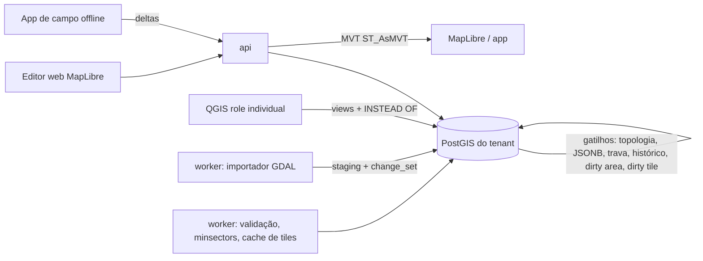

# 19d — Melhores práticas para o modelo de dados GIS

- **Data:** 12/10/2026
- **Escopo:** modelo de dados de redes de água, esgoto, drenagem e resíduos sólidos; topologia; edição e histórico;
  coleta em campo; importação; publicação; integrações.
- **Base lida:** `intelligence/sigsan-gis/.../V2_3__create_gis_schema.sql`, `GisNetworkElement.java`,
  `NetworkTopologyBuilder.java`, `ARQUITETURA-ALVO.md` §4, ADR-0028 item b, ADR-0026, ADR-0031,
  `docs/levantamento/editais/18d-aderencia-cadastro-medicao-gis.md`.
- **Restrições herdadas:** tiles pelo PostGIS servidos pela `api`, sem servidor de mapas novo (Martin, pg_tileserv,
  GeoServer e QGIS Server congelados pelo ADR-0010); QGIS direto no banco com role de login individual e restrição pela
  identidade da role (ADR-0028); app de campo em Capacitor (ADR-0026); ODA File Converter só na implantação assistida.

## 1. Diagnóstico do modelo atual

`gis_network_element` é uma tabela única com 40 tipos fixos por `CHECK`, geometria genérica `Geometry(4674)` e
`properties` JSONB livre. Serve para gerar o `.inp`, mas não sustenta cadastro técnico nem os editais (18d, itens 87,
252, 269):

1. **Tipo e subtipo misturados.** `CHECK_VALVE` e `PRESSURE_REDUCING_VALVE` são irmãos de `PIPE`; `TEE`, `CAP` e
   `REDUCER` são tipos "comuns". O tenant não cria um tipo novo sem migration nem registra o ângulo de uma curva.
2. **Sem catálogo.** `material` é texto livre, `diameter_mm` não distingue DN de diâmetro interno, e faltam classe de
   pressão, junta, fabricante e vida útil.
3. **Topologia implícita.** A conectividade é recalculada por proximidade a cada exportação (`nearestNode`, tolerância
   em graus). Sem `node_1`/`node_2`, não dá para validar, traçar nem isolar sem reconstruir o grafo.
4. **Sem ciclo de vida nem histórico.** `status` é texto, `age_years` é armazenado (envelhece errado) e não há
   projetado/em obra/em operação/abandonado nem vigência.
5. **Geometria fraca.** Tipo misto, sem Z, sem metadados de acurácia, sem coluna em 3857 para tiles.
6. **Unicidade.** `element_code` tem `UNIQUE` global além de `(tenant_id, element_code)`; no schema compartilhado do
   tenant pequeno (ARQUITETURA-ALVO §3) isso impede o mesmo código em dois tenants.
7. **Sem vínculo comercial.** Não há ramal ligado à ligação (18d item 17: ligação não é entidade).

## 2. O que as referências fazem

| Referência | Ideia aproveitável |
|---|---|
| **Esri Utility Network** | Classificação em *asset group* (subtipo) e *asset type*; regras de conectividade, anexação estrutural e contenção; edição gera "áreas sujas" que só a validação limpa; isolamento com barreiras nos dispositivos isolantes; no versionamento por ramo, áreas sujas reaparecem no reconcile e no post [1][2][3]. |
| **Esri Water/Stormwater Foundation** | Conexões: cotovelo, tê, tê de redução, redução, cap, luva, flange, cruzeta, junta de expansão, colar de tomada [4]. Drenagem: boca de lobo, poço de visita, saída, BMP [5]. |
| **Giswater** | Núcleo `node`/`arc`/`connec` (+ `gully`); catálogos `cat_arc`, `cat_node`, `cat_connec`, `cat_material`, tipos em `cat_feature`; tabela base + `man_*` por tipo; edição por views `ve_*`; `state` + `state_type`; *psector* para obras previstas; *mincut* exige `node_1`/`node_2` e estado das válvulas [6][7][8][9]. |
| **TEKSI/QWAT/QGEP** | PostGIS com projeto QGIS dedicado, listas de valores em tabelas, views editáveis com gatilhos, histórico por auditoria; QWAT calcula válvulas a fechar com pgRouting [10][11][12]. |
| **CORSAN/AEGEA (03/2024)** | SIRGAS 2000/UTM e altimetria em Imbituba; RTK com ±0,10 m H e ±0,05 m V; atributos mínimos por camada (conexão com DN1/DN2, válvula com sentido de abertura, PV com cotas de tampa e fundo, TIL, caixa de ligação); distâncias ao alinhamento e ao meio-fio; croqui; conectividade; metadados ISO 19115/MGB [13]. |
| **ABNT** | NBR 12586 e NBR 12587 (cadastro de sistemas de água e de esgoto, 1992, reconfirmadas), NBR 13133 (levantamento topográfico), NBR 14166 (rede de referência cadastral) [13][14]. |

Conclusão: o padrão que se repete é **classe topológica fixa no código + tipo e catálogo configuráveis por dados +
atributos específicos por tipo**, com topologia persistida e validada, e edição por views com gatilhos quando há cliente
desktop.

## 3. Modelo de dados proposto

### 3.1 Classificação em três níveis

1. **Papel topológico** (fixo, enum no código): `NODE`, `ARC`, `CONNECTION` (ramal), `STRUCTURE` (polígono ou ponto
   que contém outros: ETA, reservatório, caixa de registro, estação elevatória), `ZONE` (setor, DMA, bacia, setor de
   coleta), `POI` (pontos sem rede: contêiner, PEV, ecoponto).
2. **Classe** (`gis_feature_class`, semeada pelo produto, equivalente ao *asset group*): `PIPE`, `FITTING`, `VALVE`,
   `HYDRANT`, `MANHOLE`, `INLET`, `CULVERT`, `CONTAINER`...
3. **Tipo** (`gis_feature_type`, extensível pelo tenant, equivalente ao *asset type*): `GATE_VALVE`,
   `BUTTERFLY_VALVE`, `AIR_VALVE`, `BLOWOFF`, `PRV`, `CHECK_VALVE`; `BEND`, `TEE`, `REDUCER`, `CAP`, `COUPLING`,
   `FLANGE_ADAPTER`; `HYDRANT_PILLAR`, `HYDRANT_UNDERGROUND`; `MANHOLE`, `CLEANOUT_TIL`, `CLEANOUT_TL`,
   `JUNCTION_BOX`; `SIPHON_INLET`...

O **item de catálogo** (`gis_catalog_item`, equivalente a `cat_arc`/`cat_node`) fixa a peça física: material, DN
principal e secundário (redução, tê de redução), ângulo (série comercial de 11°15', 22°30', 45° e 90°), classe de
pressão, junta (elástica, soldável, flangeada, eletrofusão), fabricante, diâmetro interno, rugosidade padrão, seção
(com dimensões no padrão `geom1..geom4` do SWMM) e vida útil. O que varia por exemplar (profundidade, cotas, ano,
estado) fica na feição.

### 3.2 Colunas tipadas versus JSONB

**Vira coluna tipada** o atributo usado em filtro, simbologia, tile, indicador regulatório, EPANET/SWMM ou validação
(DN, cotas, profundidade, instalação, ciclo de vida, estado, setor). **Fica em `attributes` JSONB** o que é específico
de poucos tipos e só aparece no formulário (sentido de abertura e voltas do registro, tipo de tampão, lacre).

Validação do JSONB por tipo: `gis_feature_type.attributes_schema` guarda um JSON Schema (`required`, `enum` ligados
às listas de valores). A `api` valida em Java antes de gravar. Como o QGIS não passa pela `api`, o banco precisa de
segunda barreira: `pg_jsonschema` oferece `jsonb_matches_schema()` para `CHECK` ou gatilho [15], se o RDS a oferecer;
senão, gatilho PL/pgSQL que confere chaves obrigatórias, tipos e valores de lista. O schema é versionado
(`schema_version` na feição) para que mudar o formulário não invalide o histórico.

Listas pequenas (estado, pavimento, junta, função da rede) ficam em `gis_value_list(list_code, code, label, active,
sort_order)`, com padrão de fábrica e extensão pelo tenant, como no QWAT e no Giswater; alimentam também o "Value
Relation" do QGIS.

### 3.3 Domínios cobertos

| Domínio | NODE | ARC | CONNECTION | STRUCTURE / ZONE / POI |
|---|---|---|---|---|
| Água | conexões, registros, ventosas, descargas, VRP, hidrantes, macromedidor | rede, adutora | ramal até o cavalete | ETA, reservatório, elevatória, poço; setor, DMA, zona de pressão |
| Esgoto | PV, TIL, TL, caixa de passagem e de ligação, sifão, lançamento | coletor, interceptor, emissário, recalque, sifão invertido | ramal predial | EEE, ETE; bacia e sub-bacia |
| Drenagem | PV pluvial, boca de lobo, poço de queda, lançamento | galeria, canal, bueiro, ligação boca de lobo–PV | — | bacia de detenção (nó de armazenamento + polígono), sub-bacia |
| Resíduos | — | — | — | contêiner, PEV, ecoponto, transbordo, aterro, setor e rota de coleta (frequência, turno, veículo, sequência) |

Resíduos não é rede de fluxo: as rotas usam o grafo de logradouros, e o vínculo com o imóvel serve à taxa de resíduos e
ao módulo GRS do ADR-0004.

### 3.4 Esquema em alto nível

| Tabela | Conteúdo |
|---|---|
| `gis_feature_class` | código, domínio (`WATER`, `SEWER`, `STORM`, `WASTE`), papel topológico, geometria, isolante, mapeamento EPANET/SWMM |
| `gis_feature_type` | classe, código, `attributes_schema`, `schema_version`, símbolo, zoom mínimo, origem (fábrica/tenant) |
| `gis_material` | código, C de Hazen-Williams, n de Manning, vida útil |
| `gis_catalog_item` | tipo, material, `dn_mm`, `dn2_mm`, ângulo, classe de pressão, junta, seção, fabricante |
| `gis_value_list` | listas de domínio |
| `gis_connectivity_rule` | tipo A, tipo B, relação (`CONNECTS`, `CONTAINS`, `ATTACHES`), condições |
| `gis_node` | `id` UUIDv7, `code`, tipo, catálogo, `geom` `Point Z` 4674, `geom_web` 3857, cotas de terreno, tampa e fundo, profundidade, setor |
| `gis_arc` | idem com `LineString Z`, `node_1_id`, `node_2_id`, `length_m` geodésico, cotas de montante e jusante, declividade gerada, pressurizado |
| `gis_connection` | ramal do arco ao cavalete/caixa; `arc_id`, `service_connection_id`, DN, material, distâncias ao alinhamento e ao meio-fio |
| `gis_structure`, `gis_containment` | contêineres (ETA, caixa de registro) e o que contêm |
| `gis_zone` | setor, DMA (absorve `dma_district`), zona de pressão, bacia, setor de coleta |
| `gis_poi`, `gis_waste_route`, `gis_waste_route_stop` | resíduos |
| `gis_minsector` | trechos entre válvulas isolantes |
| `gis_change_set` | pacote de edição: origem (WEB, QGIS, FIELD, IMPORT, AS_BUILT), estado, autor, revisor, OS, abrangência |
| `gis_dirty_area`, `gis_validation_issue` | pendências de validação e problemas |
| `gis_*_history` | versões anteriores (§5.2) |
| `gis_attachment` | fotos, croquis, documentos |
| `gis_import_batch`, `gis_import_raw`, `gis_cad_layer_map` | migração (§7) |
| `gis_tile_dirty` | tiles a invalidar (§8) |

`gis_network_element` vira uma **view de compatibilidade** sobre `gis_node` e `gis_arc` enquanto o
`NetworkTopologyBuilder` for adaptado. Com nós explícitos, o builder deixa de procurar o nó mais próximo e lê
`node_1_id`/`node_2_id`; válvulas e bombas, que passam a ser nós, viram ligações curtas no `.inp`, como hoje.

### 3.5 Colunas comuns às feições

`tenant_id`, `code` (único por tenant), `feature_type_id`, `catalog_item_id`, `lifecycle_status` (`PLANNED`,
`UNDER_CONSTRUCTION`, `IN_SERVICE`, `OUT_OF_SERVICE`, `ABANDONED`, `REMOVED`), `operational_status` (aberto, fechado,
parcial, avariado), `condition_rating`, `installed_on`, `removed_on`, `change_set_id`, `attributes` JSONB,
`schema_version`, metadados de qualidade (`capture_method`: RTK, estação total, amarração a trena, vetorização,
importação CAD; `h_accuracy_m`, `v_accuracy_m`, `vertical_datum`, `source_batch_id`, `source_ref` como o
`EntityHandle` do DXF), `version`, auditoria. A idade é calculada na consulta, nunca armazenada.

## 4. Topologia e conectividade

**Modelo nó-arco persistido.** Todo arco tem `node_1_id` e `node_2_id` obrigatórios quando `IN_SERVICE`. Um gatilho
`BEFORE INSERT OR UPDATE OF geom` em `gis_arc` procura nó a até `tenant.gis_snap_tolerance_m` (parâmetro do tenant, em
metros, calculado em UTM SIRGAS 2000 do fuso do tenant ou em `geography`), ajusta o vértice extremo à posição do nó e
preenche as chaves; sem nó, cria um nó `JUNCTION` ou recusa, conforme a classe. Nó inserido sobre um arco divide o
arco (como no Giswater). Isso vale para web, QGIS, app e importação, porque está no banco.

**Regras de conectividade por tipo** (`gis_connectivity_rule`): ramal só liga a arco de distribuição; hidrante só a
rede de água; redução exige DN diferente nos dois arcos; tê tem três arcos; cap tem um; válvula tem dois; PV aceita
vários arcos de entrada e um de saída (salvo exceções); boca de lobo liga a PV ou galeria por arco próprio. Registros
podem estar contidos numa caixa (`CONTAINS`).

**Validação** em job do `worker` sobre `gis_dirty_area`, como na Utility Network [2]: nó solto; arco sem nó; arcos
duplicados; autointerseção; ilhas sem fonte; DN incompatível sem peça; válvula sem estado; no esgoto e na drenagem,
declividade negativa ou abaixo da mínima, sentido contrário às cotas, ciclo em rede por gravidade, PV sem cota de
fundo; ramal sem ligação. O resultado vai para `gis_validation_issue`; feição com erro grave fica fora do traçado e da
exportação.

**Traçado.** Implementação própria em Java sobre adjacências carregadas por setor, porque o traçado depende de regras
de negócio (válvula avariada, fonte, estado) e precisa de testes unitários, como o builder atual. O isolamento segue o
*mincut* do Giswater e o *isolation trace* da Esri [3][8]: busca a partir do arco afetado que para em válvulas
isolantes operáveis (válvulas a fechar); retirado o trecho, componentes conexos a partir das fontes; o que fica sem
fonte também perde abastecimento; os ramais levam às ligações afetadas. Válvula avariada é ignorada e a busca segue
até a próxima. Pré-calcular `gis_minsector` na validação reduz o traçado a um grafo de setores. Montante/jusante no
esgoto usa o sentido do arco.

**pgRouting** fica para o que é lote e grafo de ruas: validação de componentes (`pgr_connectedComponents`), roteirização
de coleta de resíduos e leitura. A versão 3.8 depreciou `pgr_createTopology` e `pgr_analyzeGraph` em favor de
`pgr_extractVertices` e de topologia mantida pelo usuário [16], o que confirma manter `node_1`/`node_2` próprios.

## 5. Edição e histórico

### 5.1 Ciclo de vida e fluxo as-built

O fluxo projeto → obra → cadastro usa `lifecycle_status` e `gis_change_set`, como o *psector* do Giswater [9]:
feições `PLANNED` pertencem a um pacote, coexistem com a rede em operação e ficam fora de traçado e indicadores; na obra
passam a `UNDER_CONSTRUCTION`; o as-built medido em campo substitui a geometria projetada e, aprovado, vira
`IN_SERVICE`, encerrando a vigência do que foi substituído. O pacote se liga à OS ou ao projeto e guarda relatório
técnico, planta, croquis e monografia de marcos [13].

**Revisão.** Pacotes `AS_BUILT`, `IMPORT` e mudanças topológicas exigem revisor diferente do autor, como a aprovação
dupla do ADR-0002; correção de atributo simples vai direto, com auditoria.

**Sem versionamento por ramo agora.** Na Utility Network ele custa áreas sujas recriadas no reconcile e no post,
validação nas duas versões e travas [2]; transação longa no banco é pior. O pacote `PLANNED` cobre projetos e obras sem
duplicar a rede.

### 5.2 Histórico temporal

Duas dimensões: **tempo do negócio** (`installed_on`, `removed_on`, vigência do ativo) e **tempo de sistema** (quando o
cadastro mudou). A tabela corrente fica simples; um gatilho grava a versão anterior em `gis_*_history` com
`valid_period tstzrange`, autor, role do banco e `change_set_id`, permitindo consulta "como estava em 31/12/2025" para
o SINISA. No PostgreSQL 17 a não sobreposição se garante com `EXCLUDE USING gist (id WITH =, valid_period WITH &&)` e
`btree_gist`; as chaves temporais `WITHOUT OVERLAPS` e `PERIOD` só existem a partir do PostgreSQL 18 [17].

### 5.3 Concorrência

A coluna `version` aplicada por `register_tenant_table` dá controle otimista na `api`. O QGIS não envia versão; para
ele, use **trava por área**: `gis_edit_lock(geom, role, change_set_id, expira_em)` e gatilho que recusa edição de
outra role dentro de área travada. No app de campo, o conflito é tratado na sincronização (§6).

### 5.4 QGIS direto no PostGIS

Mantido o desenho do ADR-0028, as práticas que reduzem risco:

1. **Role de login individual** com `USAGE` só no schema do tenant e RLS pela identidade da role no schema
   compartilhado; nunca dona das tabelas, sem `BYPASSRLS`, `FORCE ROW LEVEL SECURITY` nas tabelas editáveis, com
   `statement_timeout` e `CONNECTION LIMIT` próprios. Um relato de "QGIS ignorando permissões" se explicou por conexão
   salva com outro usuário [18]; o teste de aceite deve editar com conta real sem privilégio.
2. **Edição por views**, uma por classe (`gis_edit.v_valve`), com `security_invoker = true` e gatilhos `INSTEAD OF`
   que gravam nas tabelas base, como TEKSI e Giswater [7][10]. Os gatilhos aplicam topologia, validação de JSONB,
   trava por área e histórico. Tabelas base sem escrita para roles do QGIS.
3. **Projeto QGIS gerado pelo produto** por tenant (formulários, listas de valores, simbologia da web). Arquivo de
   serviço sem credenciais e senha no banco de autenticação do QGIS; grupos de transação ligados; chaves UUID com
   padrão no banco, evitando os problemas de sequência com "avaliar valores padrão no provedor" [19].
4. **Rede:** VPN ou IP de origem, TLS com verificação do servidor, credencial curta (IAM do RDS). Endpoint próprio,
   fora do PgBouncer em modo transaction da `api`, até testar o QGIS no pooler.
5. **Alternativa futura:** OGC API Features pela `api`, tirando o QGIS do banco; hoje esbarra no ADR-0010 e no suporte
   de escrita do cliente, a confirmar.

## 6. Dados em campo

- **Pacote offline por área:** base em PMTiles/MBTiles, feições da área em SQLite no aparelho, catálogos e listas de
  valores, com versão do pacote, no mesmo padrão da carga de rota (ARQUITETURA-ALVO §2, item 5).
- **Edições como deltas** com `client_change_id` (UUIDv7), versão de base e só os campos alterados, aplicadas num
  `gis_change_set` do tipo `FIELD`; versão de base desatualizada vai para fila de conflito por atributo. O QFieldCloud
  faz o mesmo (deltas JSON, "último vence" ou manual) e avisa que gatilhos não rodam na cópia local [20]; topologia e
  validação definitivas ficam no servidor.
- **GNSS de precisão:** receptor RTK externo por Bluetooth (NMEA) via plugin nativo, ou localização simulada do
  Android; correções NTRIP pelo celular [21]. Cada ponto guarda tipo de solução (RTK fixo, flutuante, autônomo),
  acurácias, PDOP, altura da antena. As-built só com RTK fixo dentro do limite do tenant (sugestão: ±0,10 m H e
  ±0,05 m V, como a CORSAN [13]); altitude convertida pelo modelo geoidal do IBGE, registrado em `vertical_datum`.
- **Fotos e croquis:** `gis_attachment` com posição, azimute, hora, hash e varredura no pipeline de anexos; croqui
  vetorial com as amarrações ao alinhamento predial e ao meio-fio [13].

## 7. Importação e migração

Pipeline no `worker` (ADR-0028):

1. **Conversão:** DWG → DXF pelo ODA File Converter na etapa assistida; DXF, SHP, GPKG e INP lidos com GDAL. No DXF,
   cada feição traz `Layer` e `EntityHandle`; com `DXF_INLINE_BLOCKS=FALSE` os blocos viram pontos de inserção com
   nome, escala, ângulo e atributos [22]. Blocos carregam o tipo (registro, PV); textos próximos ("DN 100 PVC", cotas)
   exigem associação espacial.
2. **Preparação:** tudo entra em `gis_import_raw` com lote e referência de origem, sem tocar no cadastro.
3. **Mapeamento CAD → tipo:** `gis_cad_layer_map` (camada, bloco, padrão de texto → classe, tipo, item de catálogo),
   revisável na tela e reaproveitável entre lotes do mesmo cliente.
4. **Georreferenciamento:** identificar a origem (SAD69, Córrego Alegre, coordenadas locais) e transformar para SIRGAS
   2000 com as grades do IBGE; sem referência, ajuste por pontos de controle com resíduo registrado.
5. **Limpeza topológica:** `ST_MakeValid`, duplicatas, segmentos curtos, snap, quebra nos nós (`ST_Node`), junção de
   polilinhas partidas, sentido do esgoto pelas cotas.
6. **Qualidade pela ISO 19157-1:2023** [23]: completude (omissão e comissão), consistência lógica (conceitual, de
   domínio, de formato, topológica), acurácia posicional (amostra RTK), acurácia temática (DN e material em amostra de
   campo) e qualidade temporal. O relatório fica no `gis_change_set` e alimenta metadados ISO 19115/MGB.
7. **Publicação** como pacote `IMPORT` revisado, com `capture_method = CAD_IMPORT` e acurácia estimada, que o as-built
   posterior substitui.

## 8. Publicação e desempenho

- **Tiles pela `api`** com `ST_AsMVT`/`ST_AsMVTGeom` e `ST_TileEnvelope`, extent 4096, buffer 64 e filtro pelo
  envelope com margem para usar o índice [24]. Coluna `geom_web` (3857) gerada e indexada evita `ST_Transform` por
  tile.
- **Uma camada MVT por domínio e papel** (água-arcos, água-nós...), com atributos mínimos (id, tipo, DN, material,
  ciclo de vida); o detalhe vem da `api` ao clicar. Zoom mínimo por tipo: em zoom baixo, só adutoras e DN maiores;
  ramais e conexões a partir de z17.
- **Pontos densos** (ligações, hidrômetros, OS): agregação no servidor por grade ou `ST_ClusterDBSCAN` em zoom baixo,
  em vez de agrupamento de GeoJSON no navegador, que gera os tiles no cliente e não escala [25].
- **Simbologia** gerada de `gis_feature_type` num estilo MapLibre por tenant, com expressões `match`; seleção por
  `feature-state` com `promoteId`.
- **Cache:** tile com dado de tenant não vai para cache público de CDN. Cache na `api` ou em objeto com chave
  `(tenant, camada, z, x, y, versão)`; gatilho de edição registra em `gis_tile_dirty` os tiles afetados (z10–z18) e o
  `worker` invalida; `ETag` pela versão da camada.
- **Índices e volume:** GiST em `geom` e `geom_web`; B-tree em tipo, `node_1_id`, `node_2_id`; índices parciais para
  `IN_SERVICE`. Com schema por tenant, um município grande tem centenas de milhares de feições por tabela; particionar
  só se justifica com dezenas de milhões de linhas, e complicaria chaves e gatilhos de topologia.
- **Martin** é plano B, como exceção ao ADR-0010, se a latência pela `api` não atender; aceita funções PostGIS como
  fonte [26].

## 9. Integrações

- **Feição ↔ ligação ↔ imóvel ↔ hidrômetro.** `gis_connection.service_connection_id` aponta para a ligação do
  cadastro comercial (entidade a criar, 18d item 17). O hidrômetro pertence à ligação, não ao GIS; o mapa o mostra por
  junção. A unidade consumidora mantém sua coordenada, e o ramal liga as duas pontas.
- **OS e manobras.** OS referencia feição e, quando altera a rede, abre ou fecha um `gis_change_set`. A manobra gera
  `gis_isolation_plan` (válvulas a fechar em ordem, estado anterior, imóveis afetados, avisos e OS em lote), e a baixa
  da OS atualiza `operational_status` das válvulas.
- **EPANET.** Exportação direta de `gis_node`/`gis_arc` em `IN_SERVICE` (ou de um pacote `PLANNED` para cenário), com
  rugosidade do material e demanda vinda do consumo faturado pelas ligações do nó.
- **SWMM** para esgoto e drenagem: junção = PV (cota de fundo, profundidade máxima = tampa − fundo); conduto = arco
  com cotas de montante e jusante, seção e Manning do catálogo; armazenamento = bacia de detenção; *outfall* = ponto de
  lançamento; sub-bacias = polígonos de contribuição. O SWMM 5.2 trouxe objetos de rua e de boca de lobo (*inlet*),
  o que justifica cadastrar a boca de lobo com tipo e dimensões [27].
- **Gestão de ativos (ISO 55000:2024 e ISO 55001:2024).** Probabilidade de falha por idade, material, vida útil, rompimentos (OS de
  reparo por arco) e estado; consequência pelo traçado de isolamento (ligações e clientes sensíveis), DN e local;
  risco = probabilidade × consequência, com plano de renovação e exportação ao contábil (18d item 27).
- **Indicadores.** Extensão de rede por domínio, material, faixa de DN, década de instalação e município, calculada
  pelo comprimento geodésico com `lifecycle_status = IN_SERVICE` na data de referência (histórico), alimentando o
  exportador assistido do SINISA (ADR-0004). Os códigos dos campos devem ser conferidos no glossário vigente do SINISA
  (o de 2024 foi publicado em 18/12/2025) [28].

## 10. Arquitetura de edição e publicação

Todos os caminhos de escrita convergem nos mesmos gatilhos; a validação pesada e o recálculo de setores de manobra
ficam no `worker`, de forma assíncrona, como as áreas sujas da Utility Network.

## 11. Riscos

1. **Escrita fora da `api`.** Gatilhos viram regra de negócio; erro neles afeta QGIS, web e app. Testes de banco por
   gatilho e pentest do caminho QGIS (ADR-0028).
2. **Catálogo sem curadoria.** Padrão de fábrica semeado (CORSAN, NBR 12586/12587) e extensão com aprovação.
3. **Qualidade do legado.** DWG sem georreferência nem cotas exige campo; prever amostragem RTK e registrar a acurácia
   declarada por feição.
4. **Topologia em lote.** Snap por gatilho em milhões de feições é lento; a importação usa rotina em lote no staging.
5. **Tiles privados.** Chave de cache sem tenant vaza dado; o teste de isolamento deve cobri-la.
6. **Extensões no RDS.** `pg_jsonschema` e a versão do pgRouting precisam ser confirmadas na oferta do RDS.
7. **Troca do modelo atual.** `gis_node`/`gis_arc` mudam o builder EPANET; a view de compatibilidade reduz o risco,
   mas os testes do builder precisam ser refeitos sobre a topologia persistida.

## 12. Fontes

1. Esri, *Utility network vocabulary* e API `ArcGIS.Core.Data.UtilityNetwork`:
   https://pro.arcgis.com/en/pro-app/2.6/help/data/utility-network/utility-network-vocabulary.htm;
   https://pro.arcgis.com/en/pro-app/3.6/sdk/api-reference/topic17434.html
2. Esri, *Dirty areas in a utility network*:
   https://pro.arcgis.com/en/pro-app/3.4/help/data/utility-network/dirty-areas-in-a-utility-network.htm; Esri Community,
   *Validate network topology workflow*:
   https://community.esri.com/t5/arcgis-utility-network-questions/validate-network-topology-workflow/m-p/1133812
3. Esri, *Isolation trace*: https://pro.arcgis.com/en/pro-app/help/data/utility-network/isolation-trace.htm
4. Esri, Water Distribution Foundation, domínio de conexões:
   https://solutions.arcgis.com/water/help/water-distribution-system-foundation/datadictionary/common.htm;
   https://solutions.arcgis.com/water/help/water-distribution-utility-network-foundation/DataDictionary/DataDictionary
5. Esri, *Stormwater Utility Network Foundation*:
   https://doc.arcgis.com/en/arcgis-solutions/11.5/reference/introduction-to-stormwater-utility-network-foundation.htm;
   https://doc.arcgis.com/en/arcgis-solutions/11.5/reference/other/Stormwater_UtilityNetwork.html
6. Giswater, *Logic Dbmodel*: https://docs.giswater.org/latest/en/docs/giswater/for-admins/logic-dbmodel/logic-dbmodel.html
7. Giswater dbmodel wiki (`ws_arc`, `ws_node`, `cat_material`): https://github.com/Giswater/giswater_dbmodel/wiki
8. Giswater, *Mincut*: https://docs.giswater.org/latest/en/docs/giswater/for-users/dialogs/mincut.html
9. Giswater, *Masterplan capabilities*:
   https://github-wiki-see.page/m/giswater/giswater_dbmodel/wiki/Masterplan-capabilities
10. TEKSI wastewater (VSA-DSS 2020, versão 2025.0.2): https://github.com/teksi/wastewater; QGEP datamodel:
    https://github.com/QGEP/datamodel/releases/tag/1.4.0
11. QWAT data model: https://github.com/qwat/qwat-data-model
12. Vaduva e Valean, *Adding Water Path Capabilities to QWAT Databases*, IJACSA 12(12), 2021:
    https://ftp.saiconference.com/Downloads/Volume12No12/Paper_45-Adding_Water_Path_Capabilities.pdf
13. CORSAN/AEGEA, *Padrões para Cadastro & GIS – Anexo A*, rev. 03/2024:
    https://corsan.com.br/upload/arquivos/202411/21152701-2-anexo-a-padroes-para-cadastro-e-gis.pdf
14. ABNT NBR 12586 e NBR 12587 (catálogo):
    https://www.normas.com.br/visualizar/abnt-nbr-nm/6322/abnt-nbr12586-cadastro-de-sistema-de-abastecimento-de-agua-procedimento;
    https://www.normas.com.br/visualizar/abnt-nbr-nm/6323/abnt-nbr12587-cadastro-de-sistema-de-esgotamento-sanitario-procedimento
15. Supabase, *pg_jsonschema*: https://github.com/supabase/pg_jsonschema;
    https://supabase.com/docs/guides/database/extensions/pg_jsonschema
16. pgRouting 3.8, índice e guia de migração: https://docs.pgrouting.org/3.8/en/index.html;
    https://docs.pgrouting.org/3.8/en/migration.html
17. Restrições temporais no PostgreSQL 18: https://neon.com/postgresql/18/temporal-constraints;
    https://www.depesz.com/tag/period
18. Lista pgsql-bugs, *QGIS Seem To Bypass PostgreSQL/PostGIS User Privileges*:
    https://www.postgresql.org/message-id/CAFmwTogTV+V3OL1EMXbLmr4Z1n9bp5QQBz=yLC7FJA-2cqt=cw@mail.gmail.com
19. QGIS, sistema de autenticação: https://docs.qgis.org/3.40/pt-BR/docs/user_manual/auth_system/auth_overview.html;
    `QgsProject` (grupos de transação, valores padrão no provedor): https://qgis.org/pyqgis/3.44/core/QgsProject.html;
    bug #20347: https://issues.qgis.org/issues/20347; arquivo de serviço: https://planet.qgis.org/tags/postgresql
20. QField, *QFieldCloud system documentation*: https://docs.qfield.org/de/reference/qfieldcloud/system/
21. Emlid, *Mock location*: https://docs.emlid.com/reachrx2/integration/mock-location/
22. GDAL, driver DXF: https://gdal.org/en/stable/drivers/vector/dxf.html
23. ISO 19157-1:2023: https://committee.iso.org/standard/78900.html; resumo de elementos (IHO):
    https://legacy.iho.int/mtg_docs/com_wg/DQWG/DQWG13/Draft%20Data%20quality%20checklist_18Jan2018.pdf
24. PostGIS, `ST_AsMVTGeom` e `ST_TileEnvelope`: https://postgis.net/docs/manual-3.5/ST_AsMVTGeom.html;
    https://access.crunchydata.com/documentation/postgis/3.3.1/ST_TileEnvelope.html
25. MapLibre, exemplo de clusters: https://maplibre.org/maplibre-gl-js/docs/examples/create-and-style-clusters/;
    Mapbox, *Working with large GeoJSON data*: https://docs.mapbox.com/help/troubleshooting/working-with-large-geojson-data/
26. Martin: https://github.com/maplibre/martin; https://docs.rs/crate/martin/1.13.0/source/README.md
27. EPA, *SWMM 5.2 User's Manual* e notas da 5.2.0:
    https://www.epa.gov/system/files/documents/2022-04/swmm-users-manual-version-5.2.pdf;
    https://www.epa.gov/system/files/other-files/2022-03/swmm-5.2.0-updates-and-bug-fixes.txt
28. SINISA, glossários de indicadores 2024 (água e esgoto):
    https://www.gov.br/cidades/pt-br/acesso-a-informacao/acoes-e-programas/saneamento/sinisa/resultados-sinisa/GlossriodeIndicadores_GUA_2024.pdf;
    https://www.gov.br/cidades/pt-br/acesso-a-informacao/acoes-e-programas/saneamento/sinisa/resultados-sinisa/GlossrioIndicadores_ESGOTO_2024.pdf

**Limitações desta pesquisa:** o MCP Perplexity estava indisponível (chave inválida); a pesquisa usou WebSearch,
WebFetch e leitura direta das fontes. Os códigos numéricos de domínio da Esri mudam entre versões e não foram usados.
A tabela completa de colunas do `cat_arc`/`cat_connec` do Giswater e as views do TEKSI não foram lidas no código-fonte;
as afirmações sobre elas vêm da documentação e da wiki citadas.
